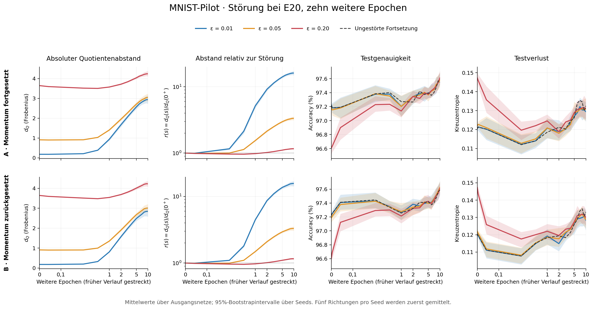
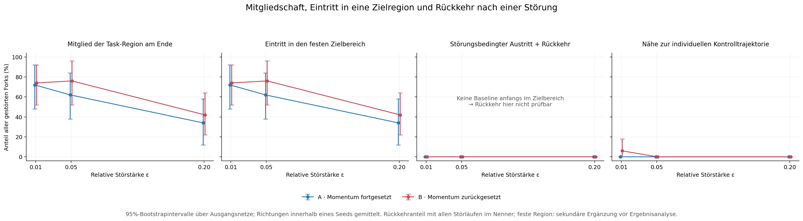

# Basin-Analyse: kontrollierter MNIST-Pilot

Funktionale Eignung am Endpunkt, ohne gesicherten strukturellen Rückkehrnachweis.

## Tatsächlich ausgeführter Umfang

300 gestörte Hauptläufe aus 10 unabhängigen Ausgangsnetzen bei E20, fünf Richtungen je Störstärke und Momentum-Protokoll. ε = 0,01; 0,05; 0,20 betrifft jeweils beide Gewichtsmatrizen. Hinzu kommen die ungestörten Fortsetzungen und Kontrollen mit abweichender Batchreihenfolge; die Endpunkttabelle enthält insgesamt 380 Läufe. Jeder Lauf umfasst zehn weitere Epochen auf dem vollständigen MNIST-Trainingssatz. 10 unabhängige Referenznetze werden bis zu denselben Trainingsständen fortgesetzt.

Die vollständig ausgeführte Erweiterung über drei Datensätze, drei Störzeitpunkte, drei Schichtvarianten und vier nichttriviale Amplituden wird im [erweiterten Ergebnisbericht](expanded_analysis.md) separat ausgewertet. Die Zahlen dieses Pilotabschnitts beziehen sich ausschließlich auf die fünf Richtungen des MNIST-Piloten.

## Vorab festgelegte Region und Rückkehr

Die primären Kriterien der zeitlich passenden Referenzhülle wurden nach Referenztraining und vor den Störungsläufen gespeichert; Zeitstempel und Referenz-Hashes stehen in [region_thresholds.json](region_thresholds.json). Die Referenzmodelle stammen aus unabhängigen Initialisierungen I1–I10 und werden nicht gestört. An jedem Messzeitpunkt wird die Region neu für den entsprechenden Trainingsstand kalibriert. Dieser zeitabhängige Bereich beschreibt einen Korridor geeigneter Lösungen, keinen festen invarianten Attraktor.

Die festen Zielbereichsanalysen, der störungsbedingte Austritt mit Rückkehr und die Unterscheidung zwischen anfänglicher und späterer lokaler Nähe wurden als **sekundäre Ergänzung** am 2026-11-16T12:38:46.173839+01:00 aufgenommen: während des Pilottrainings, vor jeglicher Pilot-Endpunkt- oder Trajektorienauswertung. Sie waren nicht Teil der vor Trainingsstart festgeschriebenen primären Analyse. Die primären Schwellen, Läufe und Trainingsprotokolle blieben unverändert. [Zeitpunkt und Begründung](analysis_amendment.json).

Der Abstand ist die Frobeniusnorm beider zusammengefasster Gewichtsmatrizen nach kanonischer ReLU-Normierung und Git-Re-Basin-Assignment. Bei einer verborgenen Schicht löst das Hungarian-Assignment die Permutationsoptimierung exakt für diesen kanonischen Abstand. Die Gauge wird nur auf Analysekopien angewendet; das SGD-Training läuft in den unveränderten Koordinaten.

Ein Zustand gehört zur Task-Region, wenn sein medianer Abstand zu den Referenzen höchstens dem 95%-Quantil ihrer Leave-one-out-Mediandistanzen entspricht **und** Accuracy sowie Loss die Referenzschwellen erfüllen. Am Endpunkt gelten:

- Strukturelle Distanzgrenze: 20.693572; alternative q90-Grenze 20.682505.
- Accuracy ≥ 97.467 % und Test-Loss ≤ 0.146274.
- Individueller Näheradius: 2.060010; zusätzlich dieselben Funktionskriterien.

Es werden zwei geometrisch verschiedene Definitionen getrennt ausgewertet:

- **Bewegte Referenzhülle:** Referenzen und Schwellen entsprechen jedem jeweiligen Trainingsstand. 136/300 gestörte Anfangszustände waren bereits Mitglied; 61/300 verlaufen von außen nach innen. Weil die Hülle selbst wandert, ist dies keine Rückkehr in eine feste Region. `retained_region` zählt 45 durchgehend innerhalb liegende Läufe, `sampled_return` 135 Eintritte nach einem an Messzeitpunkten beobachteten Außenaufenthalt.
- **Fester Zielbereich:** Die Referenznetze und Schwellen des Endhorizonts werden an allen Zeitpunkten unverändert verwendet. 0/300 gestörte Anfangszustände liegen bereits darin; 180/300 wechseln von außen nach innen. Der Eintritt kann auch gewöhnliches Weitertraining abbilden. **Störungsbedingte Rückkehr** verlangt zusätzlich, dass der ungestörte Zustand vor der Intervention innerhalb lag: 0/300 Läufe erfüllen dieses strengere Kriterium.

Die ungestörten Ausgangskonfigurationen liegen bei 0/10 Seeds im festen Zielbereich. Am Ende erfüllen 13/20 ungestörte Fortsetzungen die kombinierte Regionbedingung (beide Momentum-Protokolle). Eine Region aus nur zehn Referenzen kann selbst plausible ungestörte Netze ablehnen; ihre Grenzen sind restriktive empirische Kriterien, keine garantierten Populationsgrenzen. Die Return-Rate in den Abbildungen verwendet alle gestörten Läufe als Nenner. Die zeitliche Zuordnung erfolgt nur an gespeicherten Messzeitpunkten; Ereignisse dazwischen können übersehen werden.

## Endpunkte und Seed-Level-Unsicherheit

| Momentum | ε | r am Ende, 95%-KI | Task-Region, 95%-KI | Fester Zielbereich: außen → innen | Störungsbedingte Rückkehr | Individuelle Nähe, 95%-KI |
|---|---:|---:|---:|---:|---:|---:|
| A · Momentum fortgesetzt | 0.01 | 16.134 [14.964; 17.294] | 72.0 % [48.0 %; 92.0 %] | 72.0 % [48.0 %; 92.0 %] | 0.0 % [0.0 %; 0.0 %] | 0.0 % [0.0 %; 0.0 %] |
| A · Momentum fortgesetzt | 0.05 | 3.344 [3.121; 3.550] | 62.0 % [38.0 %; 84.0 %] | 62.0 % [38.0 %; 84.0 %] | 0.0 % [0.0 %; 0.0 %] | 0.0 % [0.0 %; 0.0 %] |
| A · Momentum fortgesetzt | 0.20 | 1.165 [1.128; 1.202] | 34.0 % [12.0 %; 58.0 %] | 34.0 % [12.0 %; 58.0 %] | 0.0 % [0.0 %; 0.0 %] | 0.0 % [0.0 %; 0.0 %] |
| B · Momentum zurückgesetzt | 0.01 | 15.646 [14.196; 16.916] | 74.0 % [52.0 %; 92.0 %] | 74.0 % [52.0 %; 92.0 %] | 0.0 % [0.0 %; 0.0 %] | 6.0 % [0.0 %; 18.0 %] |
| B · Momentum zurückgesetzt | 0.05 | 3.305 [3.056; 3.527] | 76.0 % [52.0 %; 96.0 %] | 76.0 % [52.0 %; 96.0 %] | 0.0 % [0.0 %; 0.0 %] | 0.0 % [0.0 %; 0.0 %] |
| B · Momentum zurückgesetzt | 0.20 | 1.161 [1.120; 1.196] | 42.0 % [22.0 %; 64.0 %] | 42.0 % [22.0 %; 64.0 %] | 0.0 % [0.0 %; 0.0 %] | 0.0 % [0.0 %; 0.0 %] |

Richtungen werden zuerst je Ausgangsnetz gemittelt, dann werden 10 Ausgangsnetze 10.000-mal resampelt. Angegeben sind punktweise 95%-Perzentilintervalle, keine simultanen Intervalle und keine unabhängige Stichprobe von 300 Netzen. Bei ausschließlich 0- oder 1-Werten kann der empirische Bootstrap ein Intervall ohne Breite ergeben; das beweist keine sichere Populationsrate. Die Kalibrierungsunsicherheit der kleinen Referenzkohorte ist in diesen Intervallen nicht enthalten.





## Funktionale Änderung und Erholung

Bei der größten getesteten Störung ε=0.20 verändert sich die mittlere Accuracy unmittelbar von 97.218 % auf 96.607 %, der Loss von 0.12048 auf 0.14728. Nach zehn weiteren Epochen liegen die gestörten Forks bei 97.612 % und Loss 0.13056; die zugehörigen ungestörten Fortsetzungen bei 97.567 % und Loss 0.13281. Dies beschreibt beobachtete Funktionsänderungen und ihre Erholung; kleine Störungen können bereits unmittelbar danach kaum messbaren Leistungsverlust zeigen. Die strenge Referenzschwelle für Funktionsmitgliedschaft und die direkte Erholung relativ zur eigenen Baseline sind verschiedene Kriterien.

| Momentum | ε | Accuracy vor Störung | Direkt danach | Am Ende | Loss direkt danach | Loss am Ende |
|---|---:|---:|---:|---:|---:|---:|
| preserve | 0.01 | 97.218 % | 97.226 % | 97.599 % | 0.12053 | 0.12946 |
| preserve | 0.05 | 97.218 % | 97.186 % | 97.578 % | 0.12192 | 0.13079 |
| preserve | 0.20 | 97.218 % | 96.607 % | 97.612 % | 0.14728 | 0.13113 |
| reset | 0.01 | 97.218 % | 97.226 % | 97.610 % | 0.12053 | 0.12839 |
| reset | 0.05 | 97.218 % | 97.186 % | 97.625 % | 0.12192 | 0.12880 |
| reset | 0.20 | 97.218 % | 96.607 % | 97.612 % | 0.14728 | 0.12998 |

Die Tabellenwerte mitteln zuerst Richtungen und anschließend die Ausgangsnetze. Sie beschreiben die Funktion separat vom strukturellen Rückkehrkriterium.

## Momentum und SGD-Rauschen

Protokoll A übernimmt den gespeicherten Momentumzustand in beiden Forks. Protokoll B setzt ihn in beiden Forks gleichzeitig auf null. Lernrate, Batchgröße, Aufgabe und zukünftige Batchreihenfolge bleiben innerhalb jedes gepaarten Hauptvergleichs gleich. Der direkte gepaarte Protokollvergleich mittelt Richtungen zunächst innerhalb jedes Seeds:

| ε | Differenz r: Fortsetzung − Reset (seedweise) |
|---:|---:|
| 0.01 | 0.488 [-0.257; 1.260] |
| 0.05 | 0.038 [-0.068; 0.134] |
| 0.20 | 0.004 [-0.017; 0.023] |

Kontrolle C ändert nur die zukünftige Batchreihenfolge des Vergleichsarms. Der ε=0-Lauf quantifiziert die Divergenz, die bereits ohne Gewichtsintervention durch andere SGD-Updates entsteht. r ist bei ε=0 nicht definiert und wird nicht künstlich auf null gesetzt.

| ε | Läufe | Mittlerer Endabstand | Mittlere Accuracy |
|---:|---:|---:|---:|
| 0.00 | 10 | 3.318 | 97.56 % |
| 0.20 | 50 | 4.457 | 97.59 % |

## Alternative Auswertungen und Referenzmengen

Zusätzlich zum Git-Re-Basin-Abstand sind kanonisches PIF/Hungarian-Matching und Alpha-Matching/-Dissimilarität in den Rohmesswerten gespeichert. Alpha ist ein nach Gewichtsbeträgen gewichtetes Vorzeichenmaß und keine austauschbare euklidische Distanz. Die Endpunktmitgliedschaft wird mit der engeren q90-Strukturgrenze sowie zwei getrennten Referenzhälften geprüft:

| Momentum | ε | q95-Region | q90-Strukturgrenze | Referenzhälfte A | Referenzhälfte B |
|---|---:|---:|---:|---:|---:|
| preserve | 0.01 | 72.0 % [48.0 %; 92.0 %] | 72.0 % [48.0 %; 92.0 %] | 68.0 % [42.0 %; 90.0 %] | 52.0 % [30.0 %; 74.0 %] |
| preserve | 0.05 | 62.0 % [38.0 %; 84.0 %] | 58.0 % [34.0 %; 80.0 %] | 56.0 % [34.0 %; 78.0 %] | 50.0 % [28.0 %; 72.0 %] |
| preserve | 0.20 | 34.0 % [12.0 %; 58.0 %] | 32.0 % [10.0 %; 56.0 %] | 34.0 % [10.0 %; 60.0 %] | 42.0 % [18.0 %; 66.0 %] |
| reset | 0.01 | 74.0 % [52.0 %; 92.0 %] | 74.0 % [52.0 %; 92.0 %] | 64.0 % [40.0 %; 84.0 %] | 50.0 % [28.0 %; 74.0 %] |
| reset | 0.05 | 76.0 % [52.0 %; 96.0 %] | 72.0 % [46.0 %; 94.0 %] | 72.0 % [46.0 %; 94.0 %] | 60.0 % [42.0 %; 76.0 %] |
| reset | 0.20 | 42.0 % [22.0 %; 64.0 %] | 36.0 % [16.0 %; 60.0 %] | 44.0 % [18.0 %; 72.0 %] | 52.0 % [26.0 %; 78.0 %] |

Diese Varianten dienen als Sensitivitätsanalyse. Referenzhälften mit fünf Modellen haben besonders grobe Quantile; unterschiedliche Mitgliedschaft zeigt Abhängigkeit von der operationalen Regionsdefinition.

## Loss-Barrieren

Nach kanonischem und permutativem Matching werden elf gleichmäßig verteilte Interpolationspunkte auf dem vollständigen Testset ausgewertet. Die Barriere ist der größte Loss-Überschuss gegenüber der linearen Verbindung der Endpunkt-Losswerte. Unter den gültigen Barrierewerten: Median 0.00000, Maximum 0.00000 Kreuzentropie-Einheiten (300 ausgewertete Störläufe).

Dies ist ein diskretes Raster, keine garantierte obere Schranke der kontinuierlichen Barriere. Eine kleine Barriere beschreibt eine günstige Verbindung der Endpunkte, keine Rückkehrdynamik und keinen mathematischen Attraktor.

## Divergenzen, Ausfälle und Integrität

Die maschinenlesbare Auswertungsbilanz lautet:

```json
{
  "analysis_source_sha256": "bc9a7fc6fedc9a97d2631ade192ba557d68476d402ea47f8738647b960951ab5",
  "analyzed_runs": 380,
  "complete": true,
  "config_sha256": "cc3ec4dcd10ddc7887fbdddb5ce26fc2285dbcb592ac04ae52033cc51c6ed748",
  "elapsed_seconds": 105.89626838599906,
  "expected_runs": 380,
  "max_perturbation_norm_error": 3.5177328879670844e-09,
  "metrics_source_sha256": "9988d441cc4d75c8b187fb692f4f08a5a043bab712e3cf53d2b28f311c389290",
  "n_final_failures": 0,
  "nan_endpoints": 0,
  "primary_perturbations": 300,
  "region_thresholds_sha256": "856ebbafd1bacc99d6e5ef8f63d081241cf4475ebef88735338906d828850837",
  "seed_count": 10,
  "undefined_epsilon_zero_ratios": 30,
  "undefined_nonzero_ratios": 0
}
```

Fehlgeschlagene Läufe dürfen nicht als erfolgreiche Rückkehr erscheinen. Fehlende kontinuierliche Werte werden in Seed-Mittelwerten und deren Intervallen nicht stillschweigend ausgelassen; das betreffende Gesamtergebnis bleibt undefiniert. Die separat angegebene Barriere-Spannweite beschreibt ausdrücklich nur die gültigen Barrierewerte. Ein gescheiterter oder nicht endlicher Lauf erfüllt die Rückkehrkriterien nicht; kontinuierliche Messwerte sind dort nicht sinnvoll definiert. Prüfungen zu unveränderten Originalarchiven, Symmetrien und deterministischer Fortsetzung liegen im Unterordner `validation/`.

## Interpretation nach Hypothese

**H1 – Trajektorienstabilität.** In allen untersuchten Störstärke-/Momentum-Zellen liegt selbst die untere 95%-Intervallgrenze von r über 1. Nach zehn weiteren Epochen sind die Forks von ihrer individuellen Kontrolltrajektorie weiter entfernt als unmittelbar nach der Störung. H1 wird für diesen Horizont nicht unterstützt. Deskriptiv zeigen 300/300 Störläufe während der gespeicherten Zwischenstände zumindest vorübergehend r<1 (kleinster gemessener Wert 0.9456). Vorübergehende Kontraktion und fehlende Kontraktion am Zehn-Epochen-Endpunkt sind deshalb getrennte Befunde.

**H2 – Lösungsregion.** 180/300 unmittelbar nach der Störung außerhalb des festen Zielbereichs liegende Forks erreichen ihn am Ende. Insgesamt gehören 180/300 gestörte Endpunkte zu dieser Region. In 0 Fällen lag die ungestörte Ausgangskonfiguration bereits im Zielbereich, die Störung führte hinaus und die Fortsetzung wieder hinein. Nur diese engere Kategorie weist einen beobachteten störungsbedingten Austritt mit anschließender Rückkehr aus. Hier lag jedoch keine ungestörte Ausgangskonfiguration bereits im festen kombinierten Zielbereich; das strengere störungsbedingte Rückkehrkriterium ist damit nicht prüfbar. Alle 300 gestörten Ausgangszustände lagen bereits innerhalb der festen strukturellen Grenze. Die Intervention erzeugte keinen sofortigen strukturellen Austritt; eine Rückkehr nach einem solchen Austritt wurde in diesem Raster daher nicht getestet. Das ist kein Gegenbeweis gegen H2. Eintritt in die kombinierte Region betrifft hier Funktionskriterien oder bereits bestehende strukturelle Nähe und belegt keine strukturelle Attraktion.

**H3 – Lokale Lösungsfamilie/Basin.** Die vorab festgelegte Regel für individuelle Nähe verwendet 10 % der typischen Distanz zeitlich passender unabhängiger Referenznetze plus Funktionskriterien. Diese zeitabhängige Umgebung wird in 0 Fällen nach anfänglichem Verlassen wieder erreicht. Bloße Endpunktnähe ist keine lokale Rückkehr; für eine Rückstelltendenz ist zusätzlich Kontraktion gegenüber der anfänglichen Stördistanz relevant. Eine Basin-Grenze ist mit drei Amplituden und zehn Ausgangsnetzen nicht lokalisiert.

Für die erweiterte faktorielle Untersuchung ist eine Störrichtung pro Seed und Zelle vorgesehen. Ihre vielen punktweisen Intervalle sind explorativ, ohne Korrektur für multiples Vergleichen; sie ersetzen weder die Richtungsrobustheit des Piloten noch eine Kartierung von Basin-Grenzen.

Die Aussage gilt für SGD mit konstanter Lernrate 0,1, Momentum 0,9, dem festgelegten Datenstrom und diesem Zehn-Epochen-Horizont. Gute Testleistung allein ist kein Attraktornachweis. Unabhängige Netzwerke, ReLU-Symmetrien und zufällige SGD-Abweichungen setzen unterschiedliche Vergleichsmaßstäbe.

## Methodische Quellen

- [Ainsworth et al., Git Re-Basin](https://arxiv.org/abs/2209.04836): Permutationssymmetrien und Weight Matching.
- [Garipov et al., Loss Surfaces, Mode Connectivity, and Fast Ensembling of DNNs](https://arxiv.org/abs/1802.10026): Verbindungen zwischen Lösungen und Loss-Landschaften.
- [Versuchsvorgabe](provenance/experiment_specification.md): Hypothesen, Kontrollen und Ausgaben dieses Experiments.


## Erweiterung auf alle Datensätze und Zeitpunkte

Zusätzlich zum Pilot wurden **2.160 Störläufe plus 180 Baselines** über drei Datensätze, drei Checkpoints, drei Schichtvarianten, vier Störstärken und beide Momentum-Protokolle vollständig ausgeführt. Jede Zelle enthält zehn Ausgangsnetze mit einer Richtung je Netz; die fünf Richtungen des Pilots bleiben separat ausgewertet. 0 numerische Ausfälle.

Bei gemeinsamer Störung beider Matrizen liegen 0/72 deskriptive r-Intervalle vollständig unter 1, 72/72 vollständig darüber. Damit ist die Aussage bedingungsspezifisch; eine allgemeine Rückkehr zur individuellen Kontrolltrajektorie oder eine universelle Basin-Grenze folgt daraus nicht. [Erweiterter Ergebnisbericht mit Abbildungen](expanded_analysis.md).

Alle 2160/2160 gestörten Ausgangszustände waren bereits innerhalb der festen strukturellen Region. Eine strukturelle Rückkehr nach unmittelbarem Austritt ist damit in dieser Erweiterung nicht getestet. Die 115 Rückkehren in die kombinierte Region betreffen funktionale Kriterien. [Matching-Robustheit](alignment_robustness.md).
