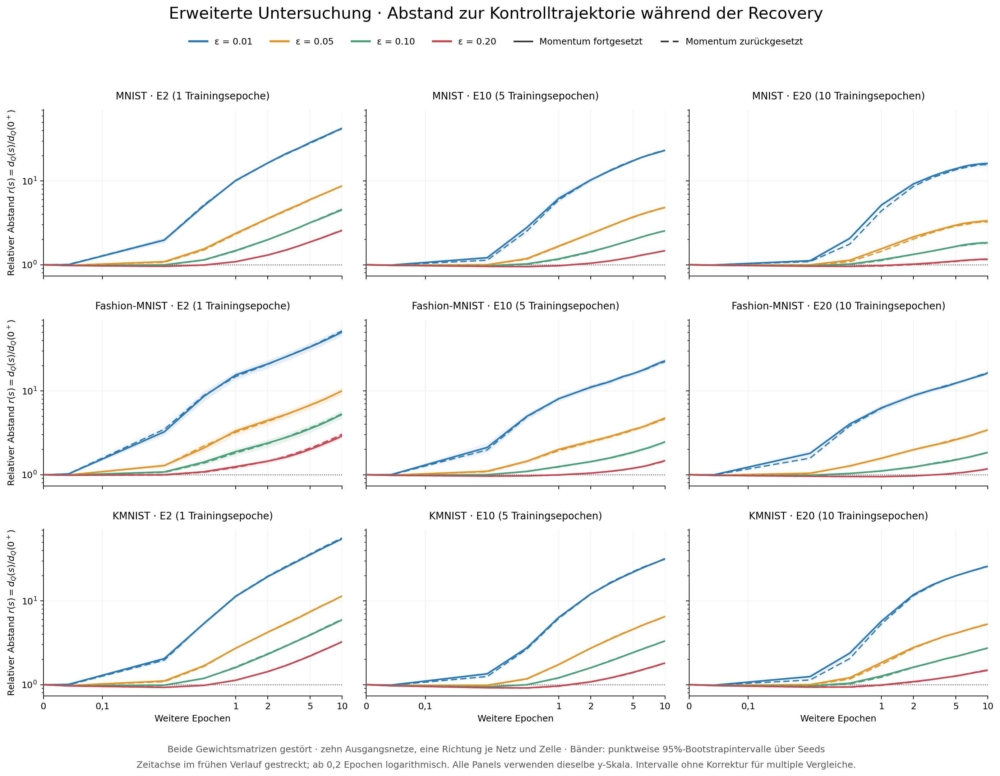
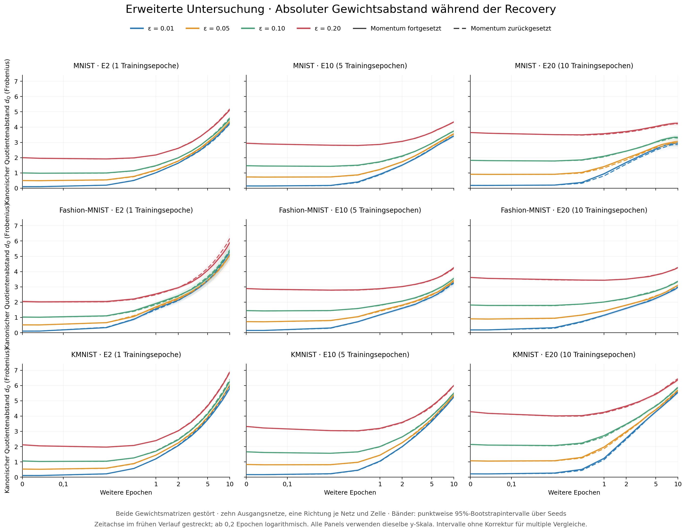
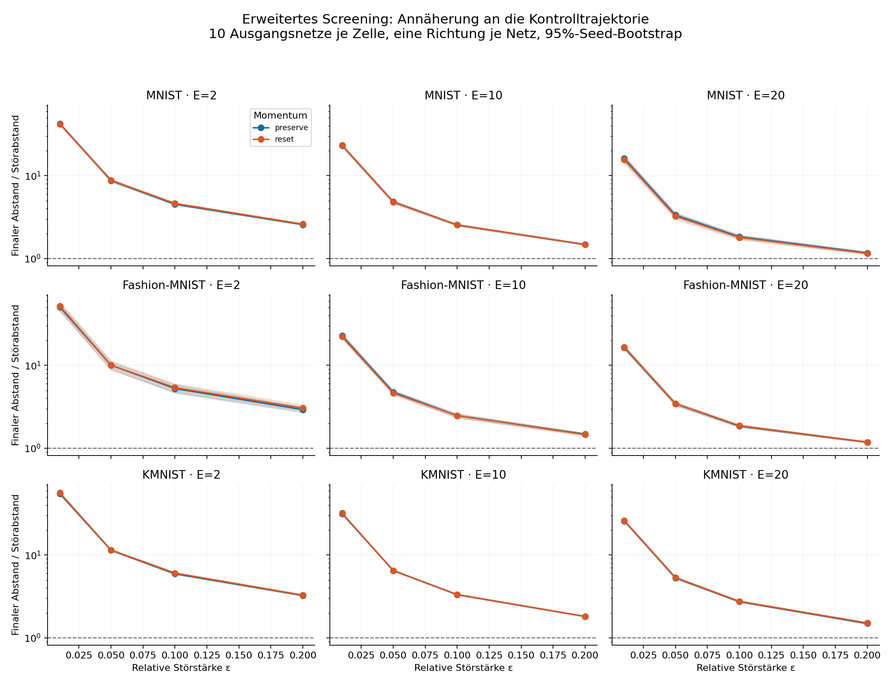
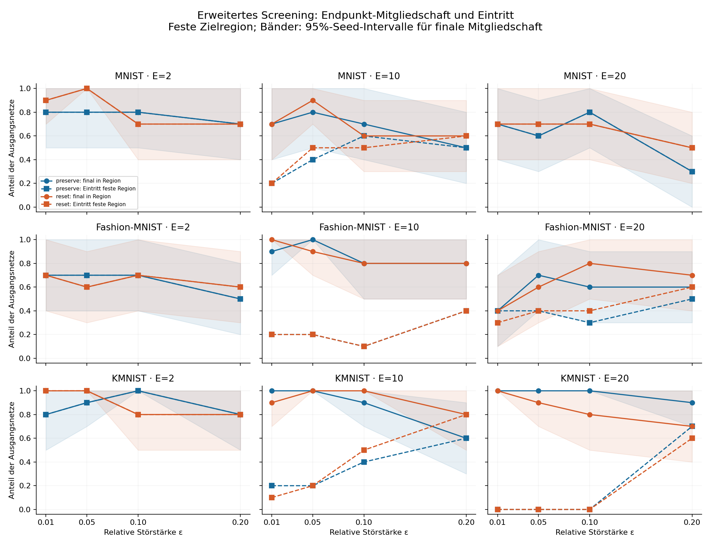
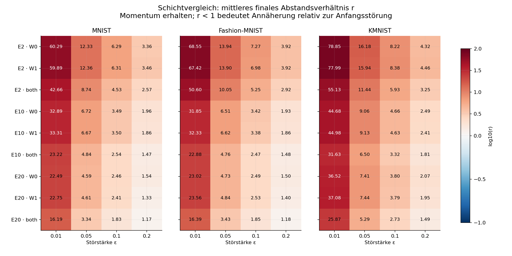

# Erweiterte Untersuchung

Die vorregistrierte Erweiterung enthält **2.160 Störläufe und 180 Baselines**, jeweils mit zehn weiteren vollständigen Trainingsepochen. Die neun Kombinationen aus MNIST/Fashion-MNIST/KMNIST und E=2/10/20 verwenden je zehn unabhängige Ausgangsnetze, beide Momentum-Protokolle, W0/W1/beide Matrizen und ε=0,01/0,05/0,10/0,20. Hinzu kommen 90 zeitlich passende unabhängige Referenzfortsetzungen und 20 neu trainierte Referenz-Ausgangsnetze. Der vorausgehende Pilot untersucht fünf Richtungen pro Ausgangsnetz; die Erweiterung **eine Richtung pro Ausgangsnetz und Zelle**.

Alle 2340 geplanten Forks wurden ausgewertet; 0 numerische Ausfälle. Für die gemeinsame Störung beider Matrizen liegen 0 von 72 deskriptiven 95%-Intervallen des relativen Abstands vollständig unter 1 und 72 vollständig darüber. Über alle Schichtvarianten liegen 0/216 Intervalle vollständig unter 1 und 216/216 vollständig darüber. Die Auswertung vieler Zellen ist explorativ; die Intervalle sind nicht für multiple Vergleiche korrigiert.

Ein r<1 zeigt Annäherung relativ zur injizierten Störung. Ein gutes Klassifikationsergebnis, die Nähe zu einer breiten Task-Region und eine niedrige Loss-Barriere beweisen jeweils alleine keine dynamische Attraktion. Die feste Zielregion verwendet Referenznetze am jeweiligen Endhorizont (11, 15 beziehungsweise 20 Trainingsepochen); das zusätzliche zeitlich passende Referenzband verändert sich entlang der Recovery. Eintritt in die feste Endregion kann auch allgemeines Weiterlernen widerspiegeln, insbesondere bei frühen Störzeitpunkten; die Baselines sind deshalb mitgespeichert. Eine Richtung pro Seed prüft nicht die Richtungsabhängigkeit innerhalb desselben Ausgangsnetzes. Eine universelle Basin-Grenze lässt sich daraus nicht ableiten.

Alle 2160/2160 gestörten Anfangszustände liegen bereits innerhalb der festen strukturellen Zielregion. Es wurden 0 strukturelle Außen→Innen-Verläufe nach einer unmittelbaren Störung beobachtet. Da kein sofortiger struktureller Austritt ausgelöst wurde, wurde H2 für die Rückkehr nach einem solchen Austritt in diesem Raster nicht getestet. Die 115 Fälle von störungsbedingtem Austritt und Rückkehr in die kombinierte Region betreffen Funktionskriterien bei anfänglich vorhandener struktureller Nähe. Dies ist kein struktureller Attraktionsnachweis.

## Gemeinsame Störung beider Matrizen

| Datensatz | E | Momentum | ε | r, Mittel [95%-KI] | Final in Region | Eintritt feste Region |
|---|---:|---|---:|---:|---:|---:|
| mnist | 2 | preserve | 0.01 | 42.657 [41.790; 43.618] | 80% | 80% |
| mnist | 2 | reset | 0.01 | 42.122 [40.871; 43.455] | 90% | 90% |
| mnist | 2 | preserve | 0.05 | 8.737 [8.422; 9.051] | 80% | 80% |
| mnist | 2 | reset | 0.05 | 8.797 [8.483; 9.085] | 100% | 100% |
| mnist | 2 | preserve | 0.10 | 4.530 [4.397; 4.656] | 80% | 80% |
| mnist | 2 | reset | 0.10 | 4.619 [4.492; 4.737] | 70% | 70% |
| mnist | 2 | preserve | 0.20 | 2.568 [2.516; 2.619] | 70% | 70% |
| mnist | 2 | reset | 0.20 | 2.601 [2.552; 2.654] | 70% | 70% |
| mnist | 10 | preserve | 0.01 | 23.222 [22.391; 24.071] | 70% | 20% |
| mnist | 10 | reset | 0.01 | 23.331 [22.445; 24.171] | 70% | 20% |
| mnist | 10 | preserve | 0.05 | 4.838 [4.665; 5.010] | 80% | 40% |
| mnist | 10 | reset | 0.05 | 4.809 [4.632; 4.982] | 90% | 50% |
| mnist | 10 | preserve | 0.10 | 2.542 [2.475; 2.608] | 70% | 60% |
| mnist | 10 | reset | 0.10 | 2.540 [2.460; 2.610] | 60% | 50% |
| mnist | 10 | preserve | 0.20 | 1.474 [1.445; 1.505] | 50% | 50% |
| mnist | 10 | reset | 0.20 | 1.476 [1.447; 1.505] | 60% | 60% |
| mnist | 20 | preserve | 0.01 | 16.185 [14.915; 17.446] | 70% | 70% |
| mnist | 20 | reset | 0.01 | 15.659 [14.052; 17.019] | 70% | 70% |
| mnist | 20 | preserve | 0.05 | 3.341 [3.122; 3.550] | 60% | 60% |
| mnist | 20 | reset | 0.05 | 3.251 [2.965; 3.505] | 70% | 70% |
| mnist | 20 | preserve | 0.10 | 1.832 [1.726; 1.934] | 80% | 80% |
| mnist | 20 | reset | 0.10 | 1.797 [1.691; 1.893] | 70% | 70% |
| mnist | 20 | preserve | 0.20 | 1.168 [1.132; 1.206] | 30% | 30% |
| mnist | 20 | reset | 0.20 | 1.156 [1.111; 1.197] | 50% | 50% |
| fashion_mnist | 2 | preserve | 0.01 | 50.600 [45.550; 55.911] | 70% | 70% |
| fashion_mnist | 2 | reset | 0.01 | 52.228 [45.660; 58.368] | 70% | 70% |
| fashion_mnist | 2 | preserve | 0.05 | 10.052 [9.098; 10.971] | 70% | 70% |
| fashion_mnist | 2 | reset | 0.05 | 10.040 [8.711; 11.407] | 60% | 60% |
| fashion_mnist | 2 | preserve | 0.10 | 5.248 [4.633; 5.821] | 70% | 70% |
| fashion_mnist | 2 | reset | 0.10 | 5.380 [4.751; 6.012] | 70% | 70% |
| fashion_mnist | 2 | preserve | 0.20 | 2.917 [2.690; 3.139] | 50% | 50% |
| fashion_mnist | 2 | reset | 0.20 | 3.054 [2.785; 3.322] | 60% | 60% |
| fashion_mnist | 10 | preserve | 0.01 | 22.884 [21.256; 24.320] | 90% | 20% |
| fashion_mnist | 10 | reset | 0.01 | 22.339 [20.937; 23.658] | 100% | 20% |
| fashion_mnist | 10 | preserve | 0.05 | 4.757 [4.516; 4.987] | 100% | 20% |
| fashion_mnist | 10 | reset | 0.05 | 4.641 [4.377; 4.889] | 90% | 20% |
| fashion_mnist | 10 | preserve | 0.10 | 2.467 [2.326; 2.605] | 80% | 10% |
| fashion_mnist | 10 | reset | 0.10 | 2.470 [2.338; 2.588] | 80% | 10% |
| fashion_mnist | 10 | preserve | 0.20 | 1.476 [1.432; 1.520] | 80% | 40% |
| fashion_mnist | 10 | reset | 0.20 | 1.460 [1.404; 1.511] | 80% | 40% |
| fashion_mnist | 20 | preserve | 0.01 | 16.391 [15.620; 17.085] | 40% | 40% |
| fashion_mnist | 20 | reset | 0.01 | 16.633 [15.828; 17.451] | 40% | 30% |
| fashion_mnist | 20 | preserve | 0.05 | 3.430 [3.242; 3.612] | 70% | 40% |
| fashion_mnist | 20 | reset | 0.05 | 3.436 [3.300; 3.567] | 60% | 40% |
| fashion_mnist | 20 | preserve | 0.10 | 1.847 [1.783; 1.907] | 60% | 30% |
| fashion_mnist | 20 | reset | 0.10 | 1.867 [1.795; 1.931] | 80% | 40% |
| fashion_mnist | 20 | preserve | 0.20 | 1.178 [1.153; 1.202] | 60% | 50% |
| fashion_mnist | 20 | reset | 0.20 | 1.182 [1.159; 1.205] | 70% | 60% |
| kmnist | 2 | preserve | 0.01 | 55.127 [53.626; 56.562] | 80% | 80% |
| kmnist | 2 | reset | 0.01 | 56.468 [54.930; 58.054] | 100% | 100% |
| kmnist | 2 | preserve | 0.05 | 11.437 [11.206; 11.655] | 90% | 90% |
| kmnist | 2 | reset | 0.05 | 11.495 [11.223; 11.782] | 100% | 100% |
| kmnist | 2 | preserve | 0.10 | 5.933 [5.790; 6.081] | 100% | 100% |
| kmnist | 2 | reset | 0.10 | 6.051 [5.918; 6.208] | 80% | 80% |
| kmnist | 2 | preserve | 0.20 | 3.249 [3.176; 3.323] | 80% | 80% |
| kmnist | 2 | reset | 0.20 | 3.274 [3.208; 3.347] | 80% | 80% |
| kmnist | 10 | preserve | 0.01 | 31.632 [31.119; 32.204] | 100% | 20% |
| kmnist | 10 | reset | 0.01 | 32.119 [31.435; 32.817] | 90% | 10% |
| kmnist | 10 | preserve | 0.05 | 6.503 [6.388; 6.615] | 100% | 20% |
| kmnist | 10 | reset | 0.05 | 6.492 [6.361; 6.630] | 100% | 20% |
| kmnist | 10 | preserve | 0.10 | 3.319 [3.269; 3.369] | 90% | 40% |
| kmnist | 10 | reset | 0.10 | 3.334 [3.275; 3.394] | 100% | 50% |
| kmnist | 10 | preserve | 0.20 | 1.811 [1.788; 1.835] | 60% | 60% |
| kmnist | 10 | reset | 0.20 | 1.811 [1.787; 1.836] | 80% | 80% |
| kmnist | 20 | preserve | 0.01 | 25.872 [25.247; 26.532] | 100% | 0% |
| kmnist | 20 | reset | 0.01 | 26.103 [25.447; 26.774] | 100% | 0% |
| kmnist | 20 | preserve | 0.05 | 5.289 [5.162; 5.426] | 100% | 0% |
| kmnist | 20 | reset | 0.05 | 5.335 [5.156; 5.507] | 90% | 0% |
| kmnist | 20 | preserve | 0.10 | 2.732 [2.676; 2.783] | 100% | 0% |
| kmnist | 20 | reset | 0.10 | 2.757 [2.689; 2.830] | 80% | 0% |
| kmnist | 20 | preserve | 0.20 | 1.488 [1.457; 1.520] | 90% | 70% |
| kmnist | 20 | reset | 0.20 | 1.507 [1.472; 1.544] | 70% | 60% |

Die Endpunkt-Mitgliedschaft verlangt gleichzeitig strukturelle Nähe und das Accuracy-/Loss-Kriterium. „Eintritt feste Region“ zählt Anfang außerhalb und Ende innerhalb; dies ist keine alleinige Attraktorentscheidung. Identische binäre Ergebnisse bei zehn Seeds können Bootstrap-Intervalle [0;0] oder [1;1] erzeugen; diese bedeuten keine populationsweite Gewissheit.

Das Gesamtmanifest aller 2.720 Versuchsfortsetzungen einschließlich Pilot und Kontrollen steht in [all_perturbation_manifest.csv](all_perturbation_manifest.csv). Die vollständigen Zahlen der Erweiterung stehen in [expanded_summary.csv](expanded_summary.csv) und [expanded_endpoints.csv](expanded_endpoints.csv). Jede Zelle enthält die eigene eingefrorene Referenzkalibrierung, vollständige Recovery-Daten, Loss-Interpolationen und Einzelprüfungen. Der Plan steht in [expanded_preregistration.json](expanded_preregistration.json). [Sekundärer Vergleich der Matching-Verfahren](alignment_robustness.md).
