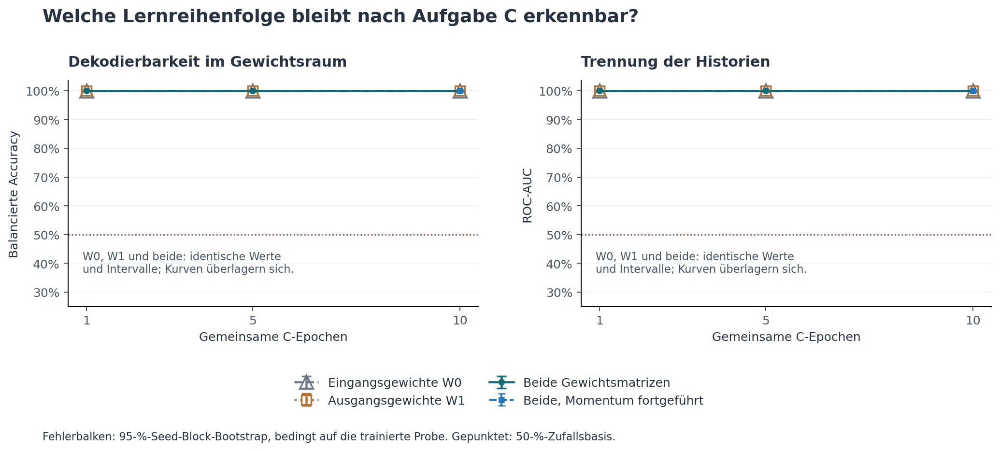
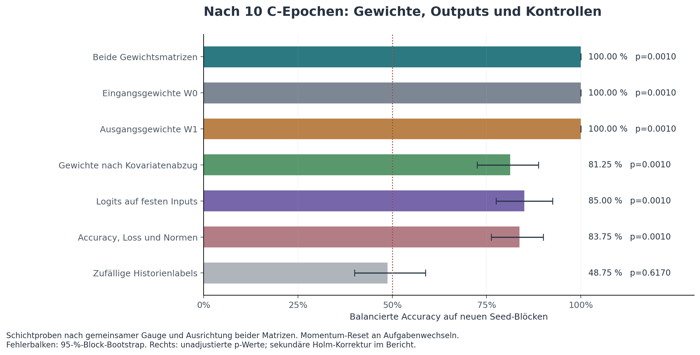

# Experiment 3: Aufgabenhistorie aus finalen Gewichten dekodieren

Die Reihenfolge A→B→C beziehungsweise B→A→C ist in diesem Pilotversuch aus den finalen Gewichten nach zehn gemeinsamen C-Epochen über Zufallsniveau dekodierbar.

Der **primäre Endpunkt** (beide kanonisch ausgerichteten Gewichtsmatrizen, Momentum-Reset, C10) erreicht **100.0 % balancierte Accuracy** auf 40 vollständig zurückgehaltenen Seed-Paaren (80 Netzen), mit 95-%-Seed-Block-Intervall [100.0 %; 100.0 %] und blockweisem Permutations-p=0.0010. ROC-AUC: 1.0000 [1.0000; 1.0000]. Der Effekt gegenüber 50 % beträgt 50.0 Prozentpunkte.

Die finale C-Accuracy beträgt für A→B→C 94.20 % und für B→A→C 93.39 %. Die gepaarte Differenz H1−H0 ist -0.81 Prozentpunkte (95-%-Intervall [-1.18; -0.48]). Die Endleistung unterscheidet sich damit messbar. Eine historische Spur unter gleicher finaler Leistung ist durch diesen Vergleich nicht nachgewiesen.

Die finale Logit-Probe ist ebenfalls erfolgreich (85.00 %; Holm-p=0.0190). Der Befund zeigt somit eine historische Spur in Gewichten und unnormalisierten Outputs; eine ausschließlich im Gewichtsraum verbleibende Spur bei identischen Netzwerkoutputs ist hier nicht nachgewiesen.

## Design und vorab festgelegter Endpunkt

200 unabhängige Initialisierungsseeds mit je zwei Historien: H=0 ist A→B→C, H=1 ist B→A→C. A verwendet Ziffernidentität, B `(y+1) mod 10`, C `(y+3) mod 10`; alle Aufgaben nutzen dieselben MNIST-Bilder und zehn Ausgänge. Architektur: 784–64–10, ReLU, feste Null-Biases. SGD mit Lernrate 0,1, Momentum 0,9 und Batchgröße 256; je eine vollständige A- und B-Epoche, anschließend zehn vollständige C-Epochen. Jede Epoche umfasst 235 Updates; gespeicherte C-Horizonte sind 1, 5 und 10. Beide Historien eines Seeds beginnen mit identischen W0/W1 und erhalten dieselbe Bildreihenfolge für denselben zeitlichen Epochenslot. In der Hauptkohorte wird Momentum an beiden Phasenübergängen zurückgesetzt.

Die Seed-Blöcke wurden in 120 Trainings-, 40 Validierungs- und 40 Testblöcke geteilt. Die L2-logistische Probe nutzt ausschließlich finale Gewichte am jeweiligen C-Horizont. Die kanonische ReLU-Gauge gleicht eingehende und ausgehende Neuronennormen an; Git Re-Basin richtet jede finale Gewichtskonfiguration auf eine eingefrorene, ausschließlich aus Trainingsgewichten bestimmte Referenz aus. Frühere Checkpoints, Momentum, Seed-Werte, Dateinamen und Historienmetadaten sind keine Gewichtsfeatures. Skalierung und Kovariatenabzug werden ausschließlich im Trainingssplit geschätzt; die Regularisierung wird auf dem blockweise getrennten Validierungssplit gewählt. Der Testsplit wird nicht für Modellwahl oder Referenzwahl verwendet.

Vor dem Anpassen irgendeiner Probe und vor Einsicht in die zurückgehaltenen Resultate wurde der Plan dokumentiert geändert: 999 statt 199 Permutationen auch für sekundäre Endpunkte; die Negativkontrolle gehört ebenfalls zur Holm-Familie mit 19 Endpunkten. Mit 199 Permutationen wäre der kleinste erreichbare p-Wert zu groß für diese Korrektur gewesen. Trainingsparameter und primärer Endpunkt blieben gleich; Einzelheiten in `provenance/pre_analysis_amendment.json`. Dies ist ein lokal eingefrorener Analyseplan, keine öffentliche Präregistrierung.

## Primärer Test: Confusion Matrix

| Wahre Historie | Vorhersage A→B→C | Vorhersage B→A→C |
| --- | ---: | ---: |
| A→B→C | 40 | 0 |
| B→A→C | 0 | 40 |

## Persistenz nach gemeinsamem C-Training

C1: 100.00 % (p=0.0010); C5: 100.00 % (p=0.0010); C10: 100.00 % (p=0.0010).

C10 ist der einzige primäre Horizont. C1 und C5 sowie Schicht- und Baselinevergleiche sind sekundär. Die drei Zeitpunkte stammen aus denselben Trajektorien und sind keine unabhängigen Wiederholungen. Unterschiede der Punktschätzer allein belegen keinen signifikanten zeitlichen Anstieg oder Abfall.

## Schichten, Kovariaten und funktionales Verhalten

W0 und W1 sind hier Schicht-Feature-Ablationen **nach gemeinsamer Normalisierung und Ausrichtung beider Matrizen**. Sowohl die kanonischen Skalierungsfaktoren als auch die Re-Basin-Zuordnung hängen von W0 und W1 ab. Erfolg einer solchen Schichtprobe belegt deshalb keine unabhängige Dekodierbarkeit aus der jeweiligen rohen Matrix allein; der primäre Endpunkt verwendet ausdrücklich beide Matrizen.

| Probe | Bal. Accuracy | KI unten | KI oben | AUC | p | Holm-p sekundär |
| --- | --- | --- | --- | --- | --- | --- |
| Eingangsgewichte W0 | 100.00 % | 100.00 % | 100.00 % | 1.0000 | 0.0010 | 0.0190 |
| Ausgangsgewichte W1 | 100.00 % | 100.00 % | 100.00 % | 1.0000 | 0.0010 | 0.0190 |
| Beide Gewichtsmatrizen | 100.00 % | 100.00 % | 100.00 % | 1.0000 | 0.0010 | – |
| Accuracy, Loss und Normen | 83.75 % | 76.25 % | 90.00 % | 0.9369 | 0.0010 | 0.0190 |
| Logits auf festen Inputs | 85.00 % | 77.50 % | 92.50 % | 0.9044 | 0.0010 | 0.0190 |
| Gewichte nach Kovariatenabzug | 81.25 % | 72.50 % | 88.75 % | 0.9062 | 0.0010 | 0.0190 |

Die reine Diagnoseprobe aus Accuracy, Loss und Normen erreicht 83.75 % (p=0.0010, Holm-p=0.0190). Bereits diese groben Eigenschaften unterscheiden die Historien nach Holm-Korrektur; die Gewichtsdekodierung ist daher zusammen mit diesen Unterschieden zu interpretieren.

Nach ausschließlich im Trainingssplit geschätztem linearem Kovariatenabzug verbleiben 81.25 % (p=0.0010). Dieser Abzug kontrolliert lineare Zusammenhänge mit den erfassten Diagnosen; er ist kein Beweis vollständiger funktionaler Gleichheit.

Die Probe auf finalen Logits erreicht 85.00 % (p=0.0010, Holm-p=0.0190). Auch die unnormalisierten Netzwerkoutputs auf dem festen Inputsatz enthalten damit nach Holm-Korrektur dekodierbare Historieninformation. Die Probe betrachtet Werte vor der Softmax-Normierung: Gemeinsame Logit-Verschiebungen können dekodierbar sein, obwohl Softmax-Wahrscheinlichkeiten und vorhergesagte Klassen gleich bleiben. Unterschiede dieser Größen wurden mit dieser Probe nicht unmittelbar geprüft.

## Finale Aufgabe und Leistungsniveau

Leistung auf dem unveränderten offiziellen MNIST-Testsplit, für die Historien der zurückgehaltenen Seed-Blöcke:

| Historie | Netze | Accuracy Mittel | Accuracy SD | Loss Mittel | Loss SD |
| --- | --- | --- | --- | --- | --- |
| 0 | 40 | 94.20 % | 0.67 % | 0.2128 | 0.0251 |
| 1 | 40 | 93.39 % | 0.99 % | 0.2374 | 0.0347 |

Gepaarte Differenz H1 minus H0, mit Seed-Block-Bootstrap-Intervall:

| Messgröße | Differenz H1−H0 | KI unten | KI oben |
| --- | --- | --- | --- |
| Accuracy (Prozentpunkte) | -0.8065 | -1.1788 | -0.4812 |
| Cross-Entropy-Loss | 0.0246 | 0.0124 | 0.0374 |

Die finale C-Accuracy beträgt für A→B→C 94.20 % und für B→A→C 93.39 %. Die gepaarte Differenz H1−H0 ist -0.81 Prozentpunkte (95-%-Intervall [-1.18; -0.48]). Die Endleistung unterscheidet sich damit messbar. Eine historische Spur unter gleicher finaler Leistung ist durch diesen Vergleich nicht nachgewiesen. Ähnliche Mittelwerte oder ein Intervall, das null enthält, begründen keine formale Äquivalenz. Es wurde keine nachträgliche Auswahl von Netzen nach ihrer Testleistung vorgenommen. Die Diagnoseprobe und der Kovariatenabzug ergänzen diese Leistungsbeschreibung.

## Momentum- und Negativkontrolle

Fortgeführtes Momentum, beide Gewichtsmatrizen: C10: 100.00 % (p=0.0010).

Zusätzlich zu den 400 primären Trainingsläufen wurden 400 Läufe mit fortgeführtem Momentum berechnet (800 neue Läufe insgesamt). Die Momentumkontrolle verwendet dieselben Seed-Blöcke und ist eine gepaarte Robustheitsanalyse; sie zählt nicht als unabhängige Replikation.

Zufällige, innerhalb der Seed-Paare getauschte Historienlabels: 48.75 %, 95-%-Intervall [40.00 %; 58.75 %], p=0.6170. Eine einzelne endliche Stichprobe muss nicht exakt 50 % ergeben.

## Symmetrie-Kontrolle

| Momentum | Gewichtskonfigurationen | Max. Umordnungsfehler | Max. Gauge-Fehler |
| --- | --- | --- | --- |
| continued | 1200 | 0 | 3.55e-15 |
| reset | 1200 | 0 | 3.11e-15 |

Jede finale Gewichtskonfiguration wurde erneut nach zufälliger Hidden-Unit-Umordnung und nach positiver ReLU-Reskalierung ausgerichtet. Berichtet ist die maximale absolute Änderung der ausgerichteten Gewichtsfeatures. Identische Features liefern für dieselbe eingefrorene Probe identische Vorhersagen; Gauge-Abweichungen im Bereich der numerischen Rundung werden separat ausgewiesen.

## Inferenz und Reichweite

Der primäre p-Wert basiert auf 999 Monte-Carlo-Permutationen. In jeder Permutation werden die Historienlabels unabhängig innerhalb vollständiger Seed-Paare getauscht, die logistische Probe neu angepasst und die Regularisierung erneut auf dem Validierungssplit gewählt. Labelunabhängige, bereits ausschließlich aus Trainingsdaten berechnete Transformationen können dabei identisch bleiben. Der einseitige p-Wert verwendet die Plus-eins-Korrektur; er misst den Anteil mindestens so hoher Test-Accuracy unter der Nullverteilung. Sekundäre Einzel-p-Werte werden zusätzlich innerhalb der deklarierten Sekundärfamilie nach Holm korrigiert; der primäre Test wird separat berichtet.

95-%-Intervalle stammen aus dem Resampling vollständiger Test-Seed-Blöcke mit beiden Historien. Sie sind bedingt auf den fest trainierten und ausgewählten Klassifikator und erfassen nicht die zusätzliche Variation durch eine neue Trainingskohorte, einen neuen Split oder eine andere Referenz. Bei mindestens einem Endpunkt kollabiert das Bootstrap-Intervall auf einen Punkt. Insbesondere bei fehlerfreier Klassifikation lässt der empirische Bootstrap keine neuen Fehlertypen entstehen; daraus folgt keine garantierte perfekte Generalisierung auf die Population.

Ein positiver Befund zeigt rekonstruierbare Information über genau diese beiden Aufgabenreihenfolgen in den finalen Gewichten. Er beweist weder die Rekonstruktion jedes SGD-Schrittes noch einen Attraktor. Eine erfolgreiche funktionale Probe zeigt darüber hinaus verbleibende Information in unnormalisierten Outputs auf den festgelegten Probe-Inputs. Ein negatives lineares Resultat schließt nichtlineare Dekodierbarkeit oder andere historische Labels nicht aus. Der Pilot ist keine unabhängige Bestätigungskohorte; bei kleinen oder instabilen Effekten ist eine weitere Kohorte erforderlich.

## Vollständige Endpunkte

| Momentum | C-Epochen | Probe | Bal. Accuracy | AUC | p | Holm-p | Permutationen |
| --- | --- | --- | --- | --- | --- | --- | --- |
| reset | 1 | Eingangsgewichte W0 | 100.00 % | 1.0000 | 0.0010 | 0.0190 | 999 |
| reset | 1 | Ausgangsgewichte W1 | 100.00 % | 1.0000 | 0.0010 | 0.0190 | 999 |
| reset | 1 | Beide Gewichtsmatrizen | 100.00 % | 1.0000 | 0.0010 | 0.0190 | 999 |
| reset | 1 | Accuracy, Loss und Normen | 85.00 % | 0.9637 | 0.0010 | 0.0190 | 999 |
| reset | 1 | Logits auf festen Inputs | 96.25 % | 0.9962 | 0.0010 | 0.0190 | 999 |
| reset | 1 | Gewichte nach Kovariatenabzug | 83.75 % | 0.9194 | 0.0010 | 0.0190 | 999 |
| reset | 5 | Eingangsgewichte W0 | 100.00 % | 1.0000 | 0.0010 | 0.0190 | 999 |
| reset | 5 | Ausgangsgewichte W1 | 100.00 % | 1.0000 | 0.0010 | 0.0190 | 999 |
| reset | 5 | Beide Gewichtsmatrizen | 100.00 % | 1.0000 | 0.0010 | 0.0190 | 999 |
| reset | 5 | Accuracy, Loss und Normen | 87.50 % | 0.9600 | 0.0010 | 0.0190 | 999 |
| reset | 5 | Logits auf festen Inputs | 90.00 % | 0.9387 | 0.0010 | 0.0190 | 999 |
| reset | 5 | Gewichte nach Kovariatenabzug | 75.00 % | 0.8431 | 0.0010 | 0.0190 | 999 |
| reset | 10 | Eingangsgewichte W0 | 100.00 % | 1.0000 | 0.0010 | 0.0190 | 999 |
| reset | 10 | Ausgangsgewichte W1 | 100.00 % | 1.0000 | 0.0010 | 0.0190 | 999 |
| reset | 10 | Beide Gewichtsmatrizen | 100.00 % | 1.0000 | 0.0010 | – | 999 |
| reset | 10 | Accuracy, Loss und Normen | 83.75 % | 0.9369 | 0.0010 | 0.0190 | 999 |
| reset | 10 | Logits auf festen Inputs | 85.00 % | 0.9044 | 0.0010 | 0.0190 | 999 |
| reset | 10 | Gewichte nach Kovariatenabzug | 81.25 % | 0.9062 | 0.0010 | 0.0190 | 999 |
| reset | 10 | Zufällige Historienlabels | 48.75 % | 0.5250 | 0.6170 | 0.6170 | 999 |
| continued | 10 | Beide Gewichtsmatrizen | 100.00 % | 1.0000 | 0.0010 | 0.0190 | 999 |

## Reproduzierbare Dateien

Die langlaufenden Prozesse wurden nach rund 20 Minuten mit einem Terminationssignal (Exit-Code 143) beendet und mit unverändertem Protokoll neu gestartet. Vollständige Trainingsarchive wurden vor Wiederverwendung validiert. Die 12 bereits fertigen Analyseendpunkte wurden erneut berechnet; gespeicherte Scores, Permutationsverteilungen, Koeffizienten und Indizes stimmen bitweise überein (`provenance/analysis_repeat_check.json`). Der Neustart ist keine zusätzliche experimentelle Replikation.

- `plan.json` und `probe_splits.json`: vorab eingefrorene Aufgaben, Seeds, Split und Analyseparameter.
- `history_run_manifest.csv`: Trainingsläufe, Paarung, Initialisierungs- und Checkpointhashes.
- `history_probe_results.csv`: sämtliche Endpunkte einschließlich Kontrollen und Intervallen.
- `performance_summary.csv` und `performance_paired.csv`: finale Aufgabenleistung und gepaarte Differenzen.
- `probe_diagnostics.json`: Referenz, Transformationen, Optimierung und Symmetrieprüfungen.
- `checkpoints/`: neue Trainingsarchive; die ursprünglichen Reproduktionsarchive werden nur gelesen.
- `code/training.py`, `code/probes.py`, `code/reporting.py`: ausführbarer Trainings-, Analyse- und Berichtscode.
- `provenance/experiment_specification.md`: unveränderte Kopie der ausgeführten Experimentbeschreibung.
