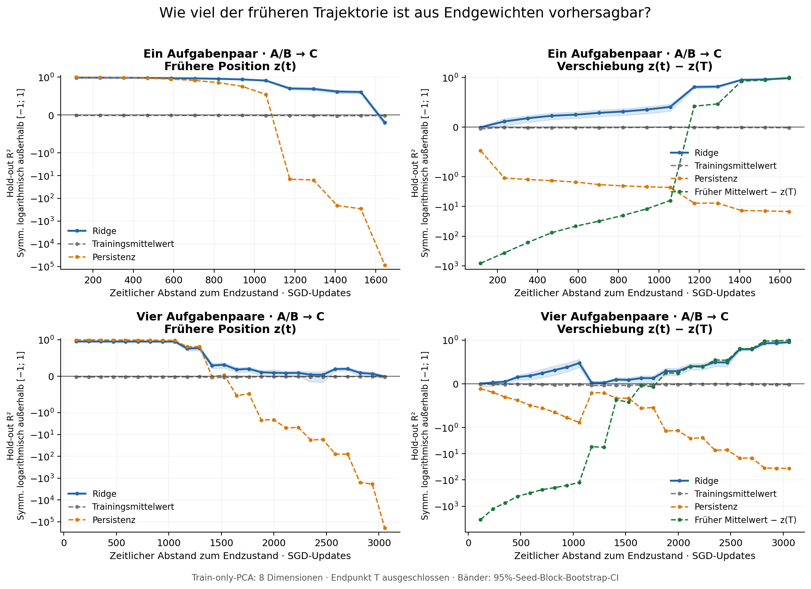
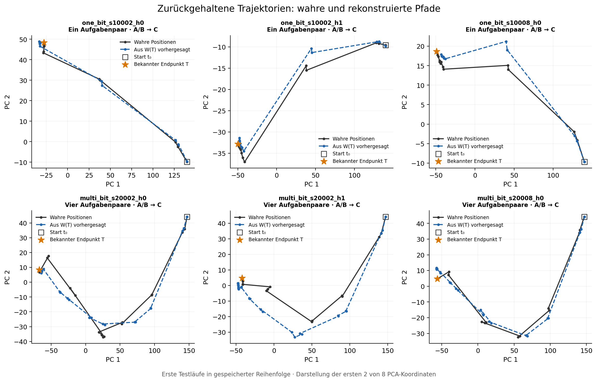
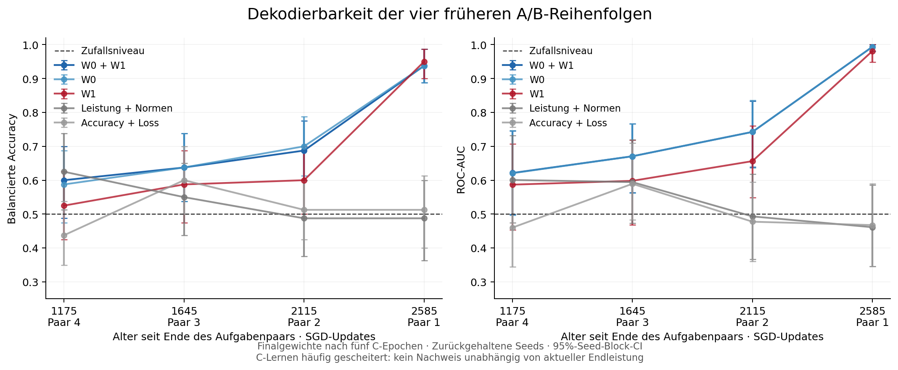

# Experiment 4 · Trajektorien- und Ereignisdekodierung

Ausgeführt im separaten Ordner `08_Trajectory_Decoding`. Die Analyse prüft, welche früheren PCA-Koordinaten und A/B-Reihenfolgen aus finalen Netzwerkgewichten auf bisher ungesehenen Initialisierungsseeds vorhersagbar sind. Die Ergebnisdateien enthalten tatsächlich berechnete Messwerte; die Originalreproduktion wird als unveränderte Eingabe verwendet.

## Primäre Ergebnisse

**Die zentrale Voraussetzung der Vier-Bit-Kohorte ist nicht erfüllt:** Nach der gemeinsamen C-Phase erreichen die Netze keine vergleichbare, erfolgreiche C-Endleistung. Über alle 400 Läufe liegt die C-Accuracy im Mittel bei 29.89 %, mit einer Spanne von 9.24 % bis 86.25 %. Die Ereignisprobes werden vollständig berichtet, erlauben unter diesen Bedingungen aber keinen Nachweis historischer Information unabhängig vom aktuellen Funktions- und Leistungszustand. Alle Läufe bleiben in der Analyse.

**Ein Aufgabenpaar · A/B → C:** Am Startzustand erreicht die primäre Ridge-Probe R² = -0.199 [95%-CI -0.287; -0.146] und MSE = 0.069374. Trainingsmittelwert: MSE 0.058941; Persistenz: MSE 4870.922. Die Probe ist schlechter als der Trainingsmittelwert; die individuelle Startposition wird mit dieser primären Probe nicht besser rekonstruiert.

**Vier Aufgabenpaare · A/B → C:** Am Startzustand erreicht die primäre Ridge-Probe R² = -0.009 [95%-CI -0.066; 0.014] und MSE = 0.029578. Trainingsmittelwert: MSE 0.029929; Persistenz: MSE 5643.951. Die MSE liegt als Punktschätzer 1.17 % unter dem Trainingsmittelwert. Bei diesem nahezu null liegenden R² ist das keine präzise Startrekonstruktion. Der Zuordnungs-Permutationstest ergibt Holm-p = 0.026; er prüft die Assoziation zwischen Vorhersage und individuellem Testverlauf, nicht eine Verbesserung gegenüber der Mittelwertbaseline. Eine belastbare Verbesserung der Rekonstruktionsgenauigkeit gegenüber dieser Baseline ist damit nicht nachgewiesen.

**Ein-Bit-Aufgabenreihenfolge:** Accuracy = 1.000 [empirisches 95%-Bootstrap-CI 1.000; 1.000], AUC = 1.000, Blockpermutations-p = 0.001, Holm-p = 0.006. Die Probe auf finaler Accuracy/Loss und Normen erreicht 87.5 % Accuracy, Accuracy/Loss allein 70.0 %. Die Historie ist damit auch mit aktuellen Leistungs-/Normunterschieden verbunden; die Gewichtsergebnisse isolieren keine davon unabhängige Erinnerung. Die fehlerfreie Klassifikation dieser Teststichprobe ist kein Beleg für perfekte Generalisierung; das empirische Bootstrap-Intervall ist am Rand degeneriert.

**Frühestes von vier Aufgabenpaaren:** Accuracy = 0.938 [empirisches 95%-Bootstrap-CI 0.887; 0.988], AUC = 0.994, Blockpermutations-p = 0.001, Holm-p = 0.024. Die Probe auf finaler Accuracy/Loss und Normen erreicht 48.8 % Accuracy, Accuracy/Loss allein 51.2 %. Diese Kontrollwerte sind zusammen mit ihren Unsicherheiten und korrigierten p-Werten zu beurteilen; eine Unabhängigkeit von aktuellen Funktionsunterschieden wird dadurch nicht nachgewiesen.

**Endleistung der Ein-Bit-Kohorte:** Die mittlere C-Accuracy liegt hier bei 92.85 %. Die beiden Historien unterscheiden sich um -1.086 Prozentpunkte (Bit 1 minus Bit 0; gesamte Kohorte). Gleiche Endleistung ist auch hier nicht durch einen Äquivalenztest belegt.

## Datengrundlage und vorab festgelegtes Vorgehen

Die Exploration verwendet 30 vorhandene Läufe mit 21 Checkpoints aus drei Datensätzen. Sie dient ausschließlich der Entwicklung und Kontrolle der Pipeline; diese kleine, heterogene Kohorte erlaubt keinen belastbaren Nachweis allgemeiner Historienrekonstruktion.

Die kontrollierten Kohorten verwenden MNIST und dieselbe Architektur 784–64–10 mit ReLU und eingefrorenen Null-Biases. Aufgaben: A = y, B = (y+1) mod 10 und C = (y+3) mod 10. Die Ein-Bit-Kohorte vergleicht A→B→C mit B→A→C. Die Vier-Bit-Kohorte enthält vier aufeinanderfolgende AB/BA-Paare und anschließend C. Pro unabhängiger Initialisierung werden zwei komplementäre Historien mit identischen Bildern und Batchfolgen trainiert. Jedes A/B-Fenster umfasst eine Epoche; C umfasst fünf Epochen. SGD: Lernrate 0,1, Momentum 0,9, Batchgröße 256. Momentum wird an jedem Phasenübergang zurückgesetzt.

Beide kontrollierten Trainingsdesigns und ihre Seed-Listen wurden vor der Auswertung kontrollierter Ergebnisse festgelegt. Die Ein-Bit-Kohorte wurde zuerst analysiert; die Erzeugung der Vier-Bit-Kohorte hing nicht von einem positiven Ein-Bit-Ergebnis ab. Das kontrollierte Protokoll wurde nicht anhand kontrollierter Testergebnisse angepasst.

| Kohorte | Unabhängige Seeds | Läufe |
| --- | --- | --- |
| multi_bit | 200 | 400 |
| one_bit | 200 | 400 |

Beide Historien eines Seeds bleiben im selben Trainings-, Validierungs- oder Testsplit. Ausrichtungsreferenz, Skalierung und PCA werden ausschließlich aus Trainingsdaten bestimmt. Die Hidden-Unit-Permutation wird anhand kanonischer Finalgewichte ermittelt und für sämtliche früheren Checkpoints desselben Laufs unverändert verwendet. Die Hauptprobe erhält ausschließlich finale Gewichte. Frühere Checkpoints definieren nur die Zielkoordinaten.

Die primäre Trajektorienanalyse verwendet acht PCA-Dimensionen und Ridge. Absolute Positionen und Verschiebungen z(t)−z(T) werden getrennt beurteilt. Der bekannte Endpunkt T ist kein Rekonstruktionsziel. Trainingsmittelwert und Persistenz z(t)≈z(T) dienen als Baselines. Zusätzlich verwendet die Verschiebungsanalyse mean_train[z(t)]−z(T): Sie kennt nur den mittleren früheren Zustand und den ohnehin bekannten Endpunkt. Dieser Kontrollprädiktor wurde nach der Exploration und vor kontrollierter Auswertung ergänzt. Seine MSE entspricht exakt der absoluten Trainingsmittelwertbaseline. Unsicherheiten beruhen auf vollständigen Seed-Blöcken.

Die Regressionsinferenz der kontrollierten Kohorten verwendet 999 Permutationen vollständiger Zieltrajektorien zwischen Test-Seed-Blöcken bei eingefrorener Probe; sie prüft die Zuordnung der Vorhersagen zu den individuellen Testverläufen, bedingt auf die trainierte Probe. Sie ist kein erneutes Training auf zufälligen Zielzuordnungen. Holm korrigiert die zusätzlichen primären Ridge-Zeitpunkte innerhalb jeder kontrollierten Kohorte. Die heterogene explorative Kohorte erhält keine inferenziellen Permutations-p-Werte. Die 95%-Intervalle verwenden 1.000 Seed-Block-Bootstrap-Stichproben aus dem Testsplit.

## Frühere Trajektorienpositionen

Startzustand t₀, primäre Gewichtskonfiguration W0+W1 mit acht PCA-Dimensionen:

| Kohorte | Ziel | R² | CI unten | CI oben | MSE | MAE | p | p Holm |
| --- | --- | --- | --- | --- | --- | --- | --- | --- |
| exploratory | absolute | 0.42361 | -0.206 | 0.478 | 0.050752 | 0.18063 | – | – |
| exploratory | displacement | 0.99733 | 0.993 | 0.998 | 2.133840 | 1.04798 | – | – |
| multi_bit | absolute | -0.00873 | -0.066 | 0.014 | 0.029578 | 0.13570 | 0.001 | 0.026 |
| multi_bit | displacement | 0.95318 | 0.940 | 0.962 | 7.067447 | 1.88857 | – | – |
| one_bit | absolute | -0.19929 | -0.287 | -0.146 | 0.069374 | 0.20760 | 0.288 | 0.288 |
| one_bit | displacement | 0.98562 | 0.982 | 0.988 | 4.429610 | 1.41970 | – | – |

R² ist relativ zur Streuung der jeweiligen Testzielkoordinaten berechnet. Ein negatives R² bedeutet eine schlechtere Vorhersage als der nachträglich bekannte Testmittelwert. Die praktisch nutzbare Mittelwertbaseline wird dagegen ausschließlich aus Trainingsdaten berechnet. Ein positiver Score allein ersetzt daher nicht den Vergleich mit Trainingsmittelwert und Persistenz. Auch Verschiebungs-R² ist kein unabhängiger Beleg für genaue Startrekonstruktion: Das subtrahierte z(T) ist bekannt und kann die Varianz von z(t)−z(T) dominieren, wenn frühe Koordinaten zwischen Runs wenig streuen. Deshalb sind absolute Koordinaten, MSE und beide Baselines gemeinsam zu lesen.

Die Beispielauswahl folgt der gespeicherten Testreihenfolge und wird nicht nach Vorhersagegüte getroffen. Die Darstellung zeigt nur zwei Koordinaten; der bekannte Endpunkt wird ausdrücklich markiert und nicht als erfolgreiche Rekonstruktion gezählt.

Anteil der Trainings-Trajektorienvarianz, den die jeweiligen PCA-Zielräume erklären:

| Kohorte | Dimensionen | Erklärte Varianz |
| --- | --- | --- |
| exploratory | 8 | 0.587 |
| exploratory | 16 | 0.890 |
| exploratory | 32 | 0.962 |
| multi_bit | 8 | 0.283 |
| multi_bit | 16 | 0.331 |
| multi_bit | 32 | 0.398 |
| one_bit | 8 | 0.276 |
| one_bit | 16 | 0.321 |
| one_bit | 32 | 0.381 |

Diese Varianzanteile beziehen sich auf die nach Layer-RMS skalierten und ausgerichteten Trainingsgewichte über alle Checkpoints. Eine gute Vorhersage des PCA-Raums belegt keine entsprechend gute Rekonstruktion sämtlicher originaler Gewichte.

Startverschiebung im Vergleich zur Kontrolle mit bekanntem Endpunkt:

| Kohorte | Prädiktor | R² | MSE | MAE |
| --- | --- | --- | --- | --- |
| exploratory | ridge | 0.997332 | 2.133840 | 1.04798 |
| exploratory | mean_early_minus_final | 0.999881 | 0.094985 | 0.22773 |
| one_bit | ridge | 0.985617 | 4.429610 | 1.41970 |
| one_bit | mean_early_minus_final | 0.999809 | 0.058941 | 0.19289 |
| multi_bit | ridge | 0.953181 | 7.067447 | 1.88857 |
| multi_bit | mean_early_minus_final | 0.999802 | 0.029929 | 0.13809 |

## Zeitlich lokalisierte Aufgabenreihenfolge

| Kohorte | Bit (0-basiert) | Alter in Updates | Accuracy | CI unten | CI oben | AUC | p | p Holm |
| --- | --- | --- | --- | --- | --- | --- | --- | --- |
| multi_bit | 0 | 2585 | 0.9375 | 0.887 | 0.988 | 0.9938 | 0.001 | 0.024 |
| multi_bit | 1 | 2115 | 0.6875 | 0.600 | 0.775 | 0.7425 | 0.002 | 0.040 |
| multi_bit | 2 | 1645 | 0.6375 | 0.537 | 0.738 | 0.6706 | 0.012 | 0.216 |
| multi_bit | 3 | 1175 | 0.6000 | 0.487 | 0.700 | 0.6212 | 0.040 | 0.600 |
| one_bit | 0 | 1175 | 1.0000 | 1.000 | 1.000 | 1.0000 | 0.001 | 0.006 |

Jedes Bit ist innerhalb eines Seed-Paars exakt balanciert; das Zufallsniveau beträgt 50 %. Die vier Bitpositionen gehören zu denselben Läufen und werden nicht als unabhängige Stichproben behandelt. Die Blockpermutation tauscht ganze Historienvektoren innerhalb eines Seeds. Sie prüft historische Information insgesamt; sie identifiziert keinen isolierten kausalen Effekt eines einzelnen Bits bei konstant gehaltenen übrigen Bits.

Die lineare Ereignisprobe ist ein L2-regularisierter Least-Squares-Klassifikator (Ridge). Die Regularisierungsstärke wird auf Validierungsseeds gewählt. Für jede der 999 Blockpermutationen wird diese Auswahl wiederholt; die p-Wert-Auflösung beträgt 1/1000 = 0,001. Die früheste Bitposition ist der vorab bestimmte primäre Ereignisendpunkt. Holm korrigiert gemeinsam alle linearen Feature×Bit-Endpunkte einer Kohorte: sechs Tests bei einem Bit, 24 bei vier Bits. Alternative Features und MLP dienen der Robustheitsprüfung.

Von der frühesten zur spätesten Bitposition betragen die Accuracies 93.75 %, 68.75 %, 63.75 %, 60.00 %; die zugehörigen Holm-p-Werte sind 0.024, 0.040, 0.216, 0.600. Das ist kein gewöhnliches Vergessensprofil mit schwächerer Dekodierbarkeit älterer Ereignisse: Hier ist das früheste Paar am besten dekodierbar. Zusammen mit dem gescheiterten C-Lernen und der fehlenden Gleichheit der Endfunktion verbietet dies eine einfache Interpretation als unverzerrtes zeitliches Gedächtnisprofil.

**Grenzfall fehlerfreier Testklassifikation:** Wenn alle Testvorhersagen richtig sind, erzeugt der empirische Seed-Bootstrap erneut nur richtige Vorhersagen und liefert das degenerierte Intervall [1; 1]. Es ist keine Garantie perfekter Populationsleistung. Als Ergänzung folgen exakte zweiseitige 95%-Clopper-Pearson-Intervalle für eine andere Zielgröße: die Wahrscheinlichkeit, bei einem neuen Seed **beide Historienarme** richtig zu klassifizieren, bedingt auf die bereits trainierte Probe. Diese Intervalle sind ausdrücklich keine exakten Intervalle der Accuracy pro einzelnem Lauf. Bei joint_all_bits müssen sämtliche Bits in beiden Historien richtig sein.

| Kohorte | Bit/Ziel | Seed-Paare | Vollständig richtige Paare | Paar-Erfolgsrate | CI unten | CI oben |
| --- | --- | --- | --- | --- | --- | --- |
| one_bit | 0 | 40 | 40 | 1.0000 | 0.9119 | 1.0000 |
| multi_bit | 0 | 40 | 35 | 0.8750 | 0.7320 | 0.9581 |
| multi_bit | 1 | 40 | 17 | 0.4250 | 0.2704 | 0.5911 |
| multi_bit | 2 | 40 | 16 | 0.4000 | 0.2486 | 0.5667 |
| multi_bit | 3 | 40 | 14 | 0.3500 | 0.2063 | 0.5168 |
| multi_bit | joint_all_bits | 40 | 1 | 0.0250 | 0.0006 | 0.1316 |

## Nachträgliche Prüfung der C-Trainingsmachbarkeit

Die abschließende Diagnose umfasst die **vollständige Vier-Bit-Kohorte mit 400 Läufen**.

C-Accuracy: Mittel 29.89 %, Minimum 9.24 %, Maximum 86.25 %. Die schwache und stark unterschiedliche Endleistung verhindert die beabsichtigte saubere Interpretation als Reihenfolgegedächtnis bei vergleichbarer erfolgreicher Endaufgabe.

Diese Diagnose wurde nach Sichtung der schwachen C-Leistung ergänzt. Sie verändert weder Curriculum, Probe-Features, Splits noch Regularisierung und entfernt keine Läufe. Die Aktivierungsprüfung verwendet fest die ersten 1.024 offiziellen MNIST-Testbilder mit der ursprünglichen Normalisierung. Eine Einheit heißt hier nur dann stichprobeninaktiv, wenn ihre ReLU-Aktivierung auf jedem dieser Bilder exakt null ist. Das ist kein Beweis global inaktiver Neuronen und kein kausaler Nachweis der Ursache der schwachen Endleistung.

Am Ende sind auf diesem festen Bildsatz im Mittel 61.16 der 64 Hidden Units inaktiv. Unmittelbar vor C sind es 60.83.

[Diagnostikprotokoll](provenance/multi_bit_feasibility_final.json) · [Werte je Lauf](provenance/multi_bit_feasibility_final.csv)

Nachträglich gewählte, rein deskriptive Schwellen: 329/400 Läufe mit C-Accuracy unter 50 %; 393/400 Läufe mit C-Accuracy unter 80 %; 400/400 Läufe mit C-Accuracy unter 90 %; 400/400 Läufe mit C-Accuracy unter 95 %. Diese Schwellen sind keine vorab festgelegten Ausschlussregeln.

Der absolute C-Accuracy-Abstand zwischen den beiden Historien desselben Seeds beträgt im Mittel 19.07 Prozentpunkte (Median 15.06; Maximum 74.23).

## Finale Leistung und Kontrollen

| Kohorte | C-Accuracy Mittel | SD | Minimum | Maximum | C-Loss Mittel |
| --- | --- | --- | --- | --- | --- |
| multi_bit | 0.299 | 0.198 | 0.092 | 0.863 | 1.760 |
| one_bit | 0.928 | 0.012 | 0.859 | 0.953 | 0.252 |

Ein gemeinsames C-Curriculum garantiert keine exakt gleiche Endleistung. Leistungs- und Norm-Probes prüfen daher, ob die Aufgabenhistorie bereits in einfachen finalen Diagnostika erkennbar ist. Solche Unterschiede begrenzen eine Interpretation als ausschließlich verborgene Gewichtsspur.

| Kohorte | Kontrolle | Bit | Accuracy | CI unten | CI oben | AUC | p | p Holm |
| --- | --- | --- | --- | --- | --- | --- | --- | --- |
| multi_bit | diagnostics | 0 | 0.487 | 0.362 | 0.600 | 0.461 | 0.633 | 1.000 |
| multi_bit | diagnostics | 1 | 0.487 | 0.375 | 0.600 | 0.493 | 0.636 | 1.000 |
| multi_bit | diagnostics | 2 | 0.550 | 0.438 | 0.650 | 0.594 | 0.216 | 1.000 |
| multi_bit | diagnostics | 3 | 0.625 | 0.512 | 0.738 | 0.601 | 0.018 | 0.306 |
| multi_bit | norms | 0 | 0.463 | 0.362 | 0.575 | 0.469 | 0.794 | 1.000 |
| multi_bit | norms | 1 | 0.463 | 0.362 | 0.563 | 0.476 | 0.770 | 1.000 |
| multi_bit | norms | 2 | 0.512 | 0.400 | 0.625 | 0.518 | 0.467 | 1.000 |
| multi_bit | norms | 3 | 0.550 | 0.450 | 0.662 | 0.606 | 0.204 | 1.000 |
| multi_bit | performance | 0 | 0.512 | 0.400 | 0.613 | 0.468 | 0.470 | 1.000 |
| multi_bit | performance | 1 | 0.512 | 0.425 | 0.600 | 0.477 | 0.467 | 1.000 |
| multi_bit | performance | 2 | 0.600 | 0.500 | 0.700 | 0.589 | 0.027 | 0.432 |
| multi_bit | performance | 3 | 0.438 | 0.350 | 0.537 | 0.460 | 0.903 | 1.000 |
| one_bit | diagnostics | 0 | 0.875 | 0.812 | 0.938 | 0.938 | 0.001 | 0.006 |
| one_bit | norms | 0 | 0.750 | 0.675 | 0.838 | 0.891 | 0.001 | 0.006 |
| one_bit | performance | 0 | 0.700 | 0.613 | 0.787 | 0.758 | 0.002 | 0.006 |

Die folgenden Leistungsdifferenzen sind innerhalb identischer Initialisierungsseeds gepaart. Δ = Leistung bei Bit 1 minus Leistung bei Bit 0; die Intervalle verwenden 1.000 Seed-Block-Bootstraps. Accuracy ist als Anteil angegeben (Δ = 0,001 entspricht 0,1 Prozentpunkten). Es wurde kein Äquivalenztest mit vorab definierter Äquivalenzmarge durchgeführt. Ein Intervall, das null enthält, belegt deshalb keine gleiche Endleistung.

Gepaarte Endleistungsunterschiede: vollständige Kohorten (deskriptiv):

| Kohorte | Bit | Maß | Seeds | Bit 0 Mittel | Bit 1 Mittel | Δ (1−0) | CI unten | CI oben |
| --- | --- | --- | --- | --- | --- | --- | --- | --- |
| multi_bit | 0 | final_accuracy | 200 | 0.30117 | 0.29658 | -0.00459 | -0.03924 | 0.03010 |
| multi_bit | 0 | final_loss | 200 | 1.75268 | 1.76785 | 0.01518 | -0.06351 | 0.09157 |
| multi_bit | 1 | final_accuracy | 200 | 0.30541 | 0.29235 | -0.01307 | -0.04659 | 0.02131 |
| multi_bit | 1 | final_loss | 200 | 1.73834 | 1.78219 | 0.04386 | -0.03186 | 0.12502 |
| multi_bit | 2 | final_accuracy | 200 | 0.31249 | 0.28527 | -0.02722 | -0.06243 | 0.00842 |
| multi_bit | 2 | final_loss | 200 | 1.72952 | 1.79101 | 0.06150 | -0.01366 | 0.13866 |
| multi_bit | 3 | final_accuracy | 200 | 0.30647 | 0.29129 | -0.01518 | -0.05050 | 0.01815 |
| multi_bit | 3 | final_loss | 200 | 1.74691 | 1.77362 | 0.02671 | -0.05567 | 0.10379 |
| one_bit | 0 | final_accuracy | 200 | 0.93391 | 0.92305 | -0.01086 | -0.01309 | -0.00877 |
| one_bit | 0 | final_loss | 200 | 0.23426 | 0.27060 | 0.03634 | 0.02925 | 0.04343 |

Gepaarte Endleistungsunterschiede: zurückgehaltene Testseeds:

| Kohorte | Bit | Maß | Seeds | Bit 0 Mittel | Bit 1 Mittel | Δ (1−0) | CI unten | CI oben |
| --- | --- | --- | --- | --- | --- | --- | --- | --- |
| multi_bit | 0 | final_accuracy | 40 | 0.29093 | 0.31368 | 0.02275 | -0.05584 | 0.10021 |
| multi_bit | 0 | final_loss | 40 | 1.78904 | 1.75580 | -0.03324 | -0.22093 | 0.14222 |
| multi_bit | 1 | final_accuracy | 40 | 0.32056 | 0.28405 | -0.03651 | -0.12086 | 0.04172 |
| multi_bit | 1 | final_loss | 40 | 1.73372 | 1.81111 | 0.07739 | -0.11150 | 0.25692 |
| multi_bit | 2 | final_accuracy | 40 | 0.33849 | 0.26611 | -0.07238 | -0.14763 | -0.00234 |
| multi_bit | 2 | final_loss | 40 | 1.69262 | 1.85221 | 0.15959 | 0.00311 | 0.32447 |
| multi_bit | 3 | final_accuracy | 40 | 0.30388 | 0.30073 | -0.00315 | -0.08419 | 0.07740 |
| multi_bit | 3 | final_loss | 40 | 1.76500 | 1.77983 | 0.01483 | -0.16131 | 0.19143 |
| one_bit | 0 | final_accuracy | 40 | 0.93386 | 0.92436 | -0.00949 | -0.01341 | -0.00564 |
| one_bit | 0 | final_loss | 40 | 0.23319 | 0.26712 | 0.03393 | 0.01983 | 0.04868 |

## Negativkontrollen und Robustheit

Unabhängig zufällige Zielkoordinaten prüfen die Regressionspipeline. Zufallslabels werden für die Ereigniskontrolle auf Seed-Blockebene vertauscht. Eine einzelne Kontrolle muss wegen Stichprobenrauschen nicht exakt R² = 0 oder Accuracy = 0,5 ergeben; entscheidend ist ein Vergleich mit Baselines und Unsicherheit.

| Kohorte | Modell | Update | R² | CI unten | CI oben | MSE |
| --- | --- | --- | --- | --- | --- | --- |
| exploratory | random_target_ridge | 0 | -0.23060 | -1.435 | -0.144 | 11.466066 |
| exploratory | random_target_mean | 0 | -0.21483 | -1.407 | -0.138 | 11.319176 |
| multi_bit | random_target_ridge | 0 | -0.00816 | -0.048 | -0.002 | 0.097589 |
| multi_bit | random_target_mean | 0 | -0.01433 | -0.054 | -0.010 | 0.098185 |
| one_bit | random_target_ridge | 0 | -0.02719 | -0.076 | -0.017 | 0.308683 |
| one_bit | random_target_mean | 0 | -0.01546 | -0.059 | -0.010 | 0.305158 |

| Kohorte | Features | Bit | Zufallslabel-Accuracy | CI unten | CI oben | AUC |
| --- | --- | --- | --- | --- | --- | --- |
| multi_bit | both | 0 | 0.475 | 0.362 | 0.575 | 0.437 |
| multi_bit | both | 1 | 0.487 | 0.388 | 0.588 | 0.491 |
| multi_bit | both | 2 | 0.525 | 0.438 | 0.613 | 0.568 |
| multi_bit | both | 3 | 0.525 | 0.425 | 0.625 | 0.497 |
| one_bit | both | 0 | 0.550 | 0.388 | 0.688 | 0.544 |

Sekundäre MLP-Ereignisprobes auf denselben Seed-Splits:

| Kohorte | Bit | Accuracy | CI unten | CI oben | AUC |
| --- | --- | --- | --- | --- | --- |
| multi_bit | 0 | 0.812 | 0.725 | 0.900 | 0.906 |
| multi_bit | 1 | 0.500 | 0.412 | 0.600 | 0.510 |
| multi_bit | 2 | 0.537 | 0.425 | 0.662 | 0.582 |
| multi_bit | 3 | 0.588 | 0.487 | 0.675 | 0.602 |
| one_bit | 0 | 1.000 | 1.000 | 1.000 | 1.000 |

Startzustandsrekonstruktion über alternative Layer, PCA-Dimensionen und Modelle:

| Kohorte | Layer | PCA-Dimension | Modell | R² | MSE |
| --- | --- | --- | --- | --- | --- |
| one_bit | both | 8 | ridge | -0.199 | 0.069 |
| one_bit | both | 16 | ridge | -0.079 | 0.066 |
| one_bit | both | 32 | ridge | -0.040 | 0.062 |
| one_bit | both | 8 | mlp | -1.869 | 0.166 |
| one_bit | W0 | 8 | ridge | -0.200 | 0.069 |
| one_bit | W0 | 16 | ridge | -0.080 | 0.066 |
| one_bit | W0 | 32 | ridge | -0.040 | 0.062 |
| one_bit | W1 | 8 | ridge | -0.205 | 0.070 |
| one_bit | W1 | 16 | ridge | -0.090 | 0.067 |
| one_bit | W1 | 32 | ridge | -0.070 | 0.064 |
| multi_bit | both | 8 | ridge | -0.009 | 0.030 |
| multi_bit | both | 16 | ridge | -0.040 | 0.032 |
| multi_bit | both | 32 | ridge | -0.035 | 0.032 |
| multi_bit | both | 8 | mlp | -0.577 | 0.046 |
| multi_bit | W0 | 8 | ridge | -0.009 | 0.030 |
| multi_bit | W0 | 16 | ridge | -0.041 | 0.032 |
| multi_bit | W0 | 32 | ridge | -0.035 | 0.032 |
| multi_bit | W1 | 8 | ridge | 0.003 | 0.029 |
| multi_bit | W1 | 16 | ridge | -0.040 | 0.032 |
| multi_bit | W1 | 32 | ridge | -0.057 | 0.033 |

Die sekundäre MLP-Probe verwendet ein ausschließlich auf finalen Trainingsgewichten bestimmtes PCA-Embedding mit bis zu 32 Dimensionen (Exploration: 17 bei 18 Trainingsläufen), 32 versteckte Einheiten und maximal 300 Optimierungsschritte. Die Validierungsdaten bestimmen den gespeicherten Schritt. Die Testdaten bestimmen weder Architektur noch Stoppzeitpunkt.

## Validierung und Schutz der Originaldaten

Der unabhängige vollständige Archive-Audit wurde bestanden: 800 Trainingsläufe wurden geprüft. Er prüft unter anderem NPZ-/PyTorch-Hashes, gespeicherte Array-Hashes, Gewichts- und Momentumzustände, Checkpoint-Raster, die rekonstruierte Bildreihenfolge, gepaarte Initialisierung, die Ereignisbalance und die Trennung der Seed-Splits.

Geschützte Originaldateien geprüft: 453; veränderte Dateien: 0. Alle geprüften Originaldateien sind unverändert.

Automatisierte technische Tests: 22 bestanden. Die Tests prüfen unter anderem train-only-Normalisierung/PCA, Unabhängigkeit der Finalfeatures von früheren Testgewichten, Umnummerierungsinvarianz, manuell nachgerechnete Metriken und die Übereinstimmung gebündelter mit seriellen Permutationsberechnungen.

Ausführungshinweis: Der erste Trainingsprozess wurde nach 594 gespeicherten Läufen durch ein externes SIGTERM beendet; der Absender ist nicht bekannt. Die Ausführung wurde mit unverändertem Code, Curriculum und Seeds fortgesetzt. Vollständige Archive wurden anhand ihrer Fingerprints geprüft und wiederverwendet. [Wiederaufnahmeprotokoll](provenance/execution_recovery.json).

## Reichweite der Ergebnisse

Eine erfolgreiche Probe belegt Vorhersagbarkeit bestimmter niedrigdimensionaler Zustandsmerkmale oder vergangener Aufgabenreihenfolgen unter diesem Curriculum. Sie belegt keine eindeutige Inversion von SGD und keine exakte Rekonstruktion der vollständigen hochdimensionalen Trainingshistorie. Insbesondere dürfen eine ähnliche PCA-Pfadform, die triviale Nähe zum bekannten Endpunkt und ein dekodierbares Ereignisbit nicht gleichgesetzt werden.

Ein Nullresultat beschränkt die gewählten Features und Probes; es beweist nicht, dass die Gewichte keinerlei historische Information enthalten. Ergebnisse beziehen sich auf MNIST, diese Architektur, die festen Labelpermutationen und fünf finale C-Epochen. Die Test-CIs beschreiben die Unsicherheit über zurückgehaltene Seed-Blöcke bei bereits trainierter Probe; sie enthalten keine Wiederholung der gesamten Kohortenerzeugung.

## Dateien und Reproduzierbarkeit

- [Run-Manifest](trajectory_run_manifest.csv) und [Probe-Splits](trajectory_probe_splits.json)
- [Alle Regressionsmesswerte](trajectory_regression_results.csv)
- [Alle Ereignisprobes](event_decoding_results.csv)
- [Gepaarte finale Leistungskontrollen](final_performance_controls.csv) und [Validierung](validation.json)
- [Nachträgliche vollständige C-Machbarkeitsdiagnose](provenance/multi_bit_feasibility_final.json)
- [Analyseplan](analysis_plan.json) und [Trainingsplan](training_plan.json)
- [Code und Ausführung](README.md)
- [Figurengalerie](plots/index.html)
