# Reproduktion: Task-dependent clustering in permutation-aligned neural network weights

Alle Messwerte wurden neu berechnet. Die publizierten Zahlen dienen ausschließlich als Referenz; das Hauptkriterium ist die qualitative Übereinstimmung.

**Zentrale qualitative Prüfungen: 17/17 bestätigt.** Deskriptive Einzelbehauptungen werden separat ausgewiesen.

## Umfang

- 30 Hauptläufe, 20 Läufe der gepaarten Aufgaben-Kontrolle und 15 Frühtrainingsläufe.
- 1.290 gespeicherte Trainingscheckpoints, inklusive Gewichten, Momentum, vollständigem Modell-/Optimiererzustand, RNG-Zuständen und Bildreihenfolge.
- 21 Haupt-, 6 Aufgaben- und 16 Frühtrainings-Analysezeitpunkte; 11.955 vollständige Paar-Zeitpunkt-Vergleiche.
- Hauptfiguren 1–6, Zusatzfiguren S1–S10, Tabellen S1–S9 und synthetischer Mehrschicht-Test.
- Rohdaten, feste Probes, Aktivierungen, Permutationen, paarweise Messwerte und Jackknife-Replikate sind gespeichert.

## Zentrale Ergebnisse

| Befund | Reproduziert | Neu berechnete Evidenz |
|---|---|---|
| Positive kanonische Gewichts-Trennung zwischen Datensätzen | Ja | 0.15768, 95%-KI [0.15302; 0.16234] |
| Keine klare Datensatz-Trennung bei Initialisierung | Ja | 0.00029, 95%-KI [-0.00050; 0.00108] |
| Positive Trennung in beiden Schichten und allen Gewichtsmaßen | Ja | positive_intervals: 16; total: 16 |
| Positive individuelle Beiträge aller Hauptläufe | Ja | positive: 480; total: 480 |
| Aufgaben-Trennung bei identischen Bildern: raw_alpha | Ja | 0.04320, 95%-KI [0.04102; 0.04538] |
| Aufgaben-Trennung bei identischen Bildern: one_minus_cka | Ja | 0.13340, 95%-KI [0.12529; 0.14152] |
| Repräsentationen bestätigen Datensatz-Trennung | Ja | 0.31774, 95%-KI [0.31029; 0.32520] |
| Gepoolte Alpha–CKA-Korrelation übersteigt Korrelation zwischen Datensätzen | Ja | all: 0.93647; within: 0.6931; between: 0.10364 |
| Strukturelle und repräsentationale Trennung vor 90% des frühen Genauigkeitsgewinns | Ja | CKA: Update 2; kanonisches Alpha: Update 2; 90%-Genauigkeitsfortschritt: Update 64 |
| Früher Genauigkeitsgewinn bei geringer Parameterbewegung | Ja | Genauigkeit 40.56%; relative Verschiebung W0 8.24%, W1 5.80% |
| ReLU-Gauge erhält Funktion und kanonische Gewichte | Ja | Maximale Abweichung: Logits 4.6e-14; kanonische Gewichte 1.8e-15 |
| Raw-Alpha reagiert auf funktionserhaltende Skalierung, Trennung bleibt positiv | Ja | 1.0: 0.1561; 1.25: 0.14791; 1.5: 0.13352; 2.0: 0.11244; 4.0: 0.098672; 8.0: 0.096288 |
| Git Re-Basin > PIF/Alpha > unaligned: weight_cosine | Ja | benchmark: 0.17452; git_rebasin: 0.28784; identity: 0.028804 |
| Git Re-Basin > PIF/Alpha > unaligned: canonical_alpha | Ja | benchmark: 0.24008; git_rebasin: 0.1495; identity: 0.47892; profile: 0.18891 |
| Git Re-Basin > PIF/Alpha > unaligned: activation_correlation | Ja | benchmark: 0.12492; git_rebasin: 0.26517; identity: 0.04526 |
| Alignment bleibt bei zufälliger Neuronenumbenennung stabil | Ja | identical_assignments: 600; total: 600 |
| Mehrschicht-Sanity-Test reduziert alle drei Dissimilaritäten | Ja | euclidean: 0.39703 → 0.0791; snd: 0.72647 → 0.28871; alpha: 0.53134 → 5.2049e-05 |

## Vergleich ausgewählter Zahlen

| Messgröße | Paper | Reproduktion | Differenz |
|---|---:|---:|---:|
| Kanonische Alpha-Trennung, E20 | 0.159 | 0.15768 | -0.00131971 |
| Aufgaben-Trennung, W0-Alpha | 0.04452 | 0.0431982 | -0.00132185 |
| Aufgaben-Trennung, 1−CKA | 0.13658 | 0.133403 | -0.00317728 |
| MNIST-Genauigkeit | 0.9737 | 0.97218 | -0.00152 |
| Fashion-MNIST-Genauigkeit | 0.8637 | 0.86708 | +0.00338 |
| KMNIST-Genauigkeit | 0.8599 | 0.86145 | +0.00155 |
| Erste CKA-Trennung (Update) | 2 | 2 | +0 |
| Erste kanonische Alpha-Trennung (Update) | 4 | 2 | -2 |
| 90%-Fortschritt (Update) | 64 | 64 | +0 |

Der vollständige Vergleich enthält 170 publizierte Referenzwerte, davon 170 automatisch zugeordnet. Siehe [paper_comparison.csv](summary/paper_comparison.csv). Numerische Abweichungen sind keine automatisch fehlgeschlagenen Replikationen.

## Unterschiede zum Paper

Die kanonische Alpha-Trennung wird hier erstmals nach 2 Updates nachweisbar (Paper: 4); das 90%-Kriterium des frühen Genauigkeitsgewinns liegt bei 64 Updates (Paper: 64). Frühe Kurven und Effektgrößen stimmen nicht punktweise überein. Die zeitliche Schlussfolgerung – Struktur entsteht während des funktionellen Lernens – bleibt erhalten.

Nach vier Updates beträgt der direkte kanonische Alpha-Kontrast 0.01625 (Paper: 0,1322). Diese deutliche numerische Abweichung bleibt als Ergebnis der Hauptrekonstruktion erhalten.

## Deskriptive Einzelbefunde

- Bestätigt: Jedes Within-Paar verbessert Aktivierungskorrelation unter PIF/Alpha. {"fraction": 1.0}
- Bestätigt: Git Re-Basin verbessert Aktivierungskorrelation gegenüber PIF/Alpha für jedes Paar. {"fraction": 1.0}
- Bestätigt: Später KMNIST-Loss steigt bei weitgehend stabiler Genauigkeit. {"E2": {"accuracy": 0.82935, "loss": 0.577304125366211}, "E20": {"accuracy": 0.8614499999999999, "loss": 0.7755100512695312}}

## Zusätzliche Sensitivitätsanalyse zum frühen Alignment

Nach Feststellung der frühen Abweichung wurde die Wahl des Matching-Verfahrens auf denselben gespeicherten Frühtrainingsgewichten untersucht. Dies ist eine nachträgliche Diagnose; die primäre Analyse und ihre Zahlen wurden nicht ersetzt. Die Methodenbeschreibung legt die frühe Assignment-Variante nicht ausdrücklich fest. Die alternative Kandidatenauswahl kann die Diskrepanz erklären, beweist aber nicht, welche Implementierung im Original verwendet wurde.

Alle Vergleichswerte und Jackknife-Replikate liegen unter [sensitivity](sensitivity/diagnostic.json).

| Assignment bei Update 4 | Kontrast | 95%-KI |
|---|---:|---|
| canonical_alpha | 0.01625 | [0.01445; 0.01806] |
| benchmark | 0.12596 | [0.09490; 0.15702] |
| git_rebasin | 0.02051 | [0.01722; 0.02380] |

## Rekonstruktionsentscheidungen und Grenzen

Die Publikation legt nicht alle Zufalls- und Implementierungsdetails fest. Verwendet werden `run_seed + epoch` als Shuffle-Seed, Batch 118 von 235 als halbe Epoche, NumPy RandomState für das Haupt-Probe-Set und kanonische Gewichte für den PIF-Kandidaten des Benchmark-Vergleichs. Seed und Initialisierung des synthetischen Tests sowie die Skalierungs-/Umbenennungs-Seeds sind explizit dokumentierte Rekonstruktionsentscheidungen.

Training: PyTorch 2.8.0 CPU, float32, NumPy 1.23.5; Analyse float64 mit SciPy 1.10.1. Betriebssystem/Python und Plotbibliothek unterscheiden sich vom Original. Die Eingangsdaten und Trainingsparameter entsprechen dem beschriebenen Versuch. Für den Aufgabenvergleich werden ausschließlich W0 und Hidden-Repräsentationen verglichen, ohne Zweischicht-Gauge.

Bestätigtes Clustering stellt weiterhin keinen Nachweis dynamischer Attraktoren oder identischer gelernter Algorithmen dar.

## Abbildungen

### figure_01

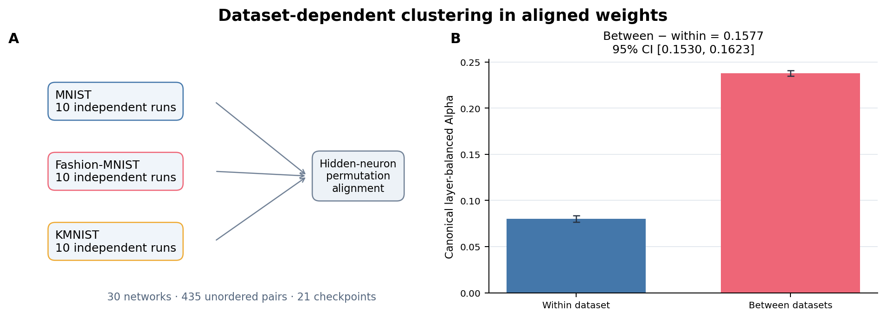

### figure_02

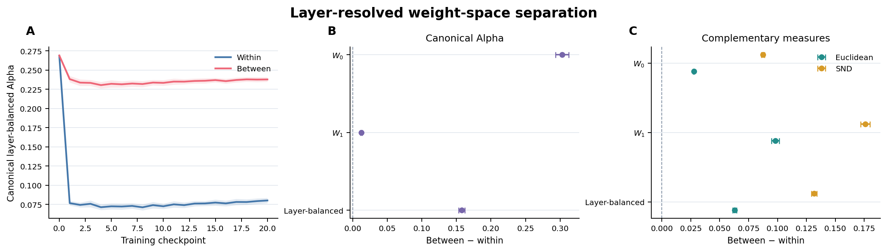

### figure_03

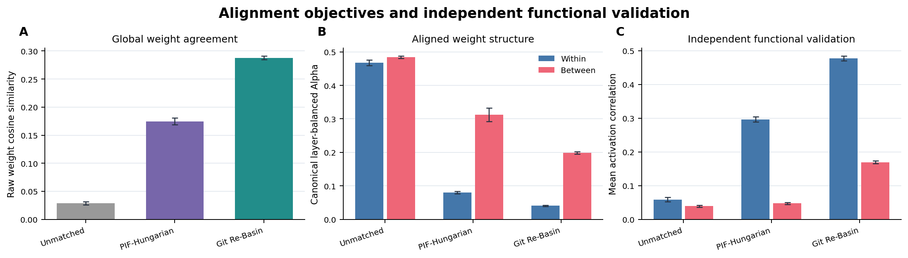

### figure_04

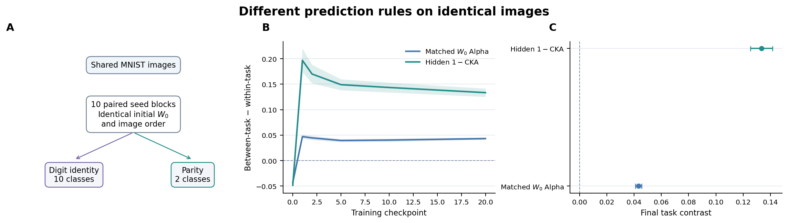

### figure_05

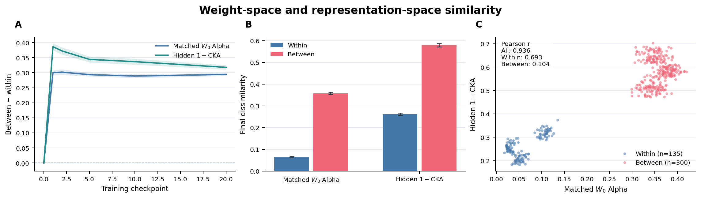

### figure_06

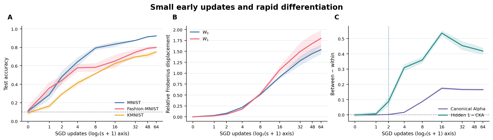

### figure_S01

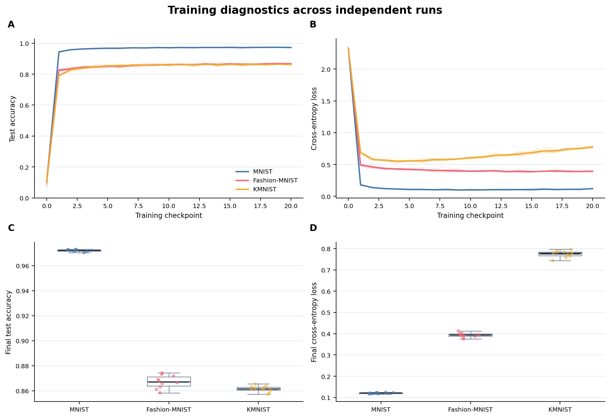

### figure_S02

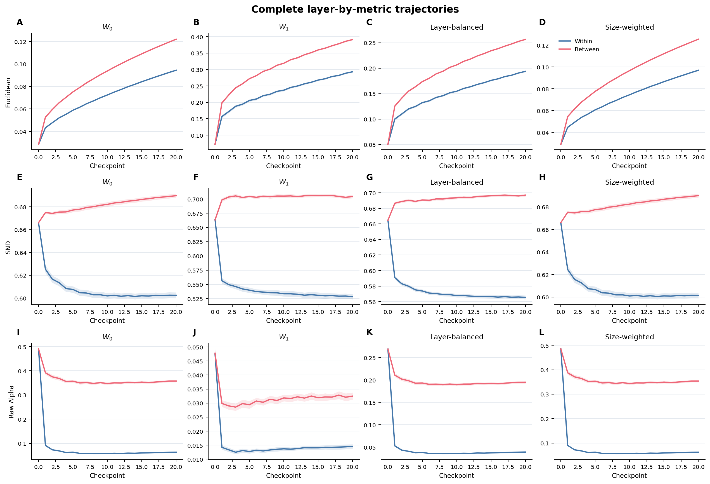

### figure_S03

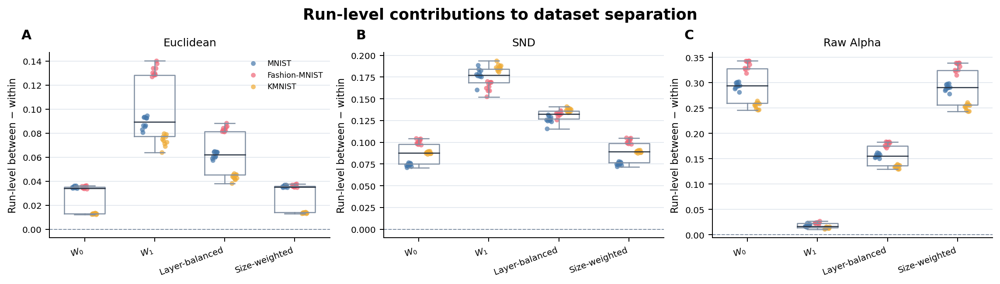

### figure_S04

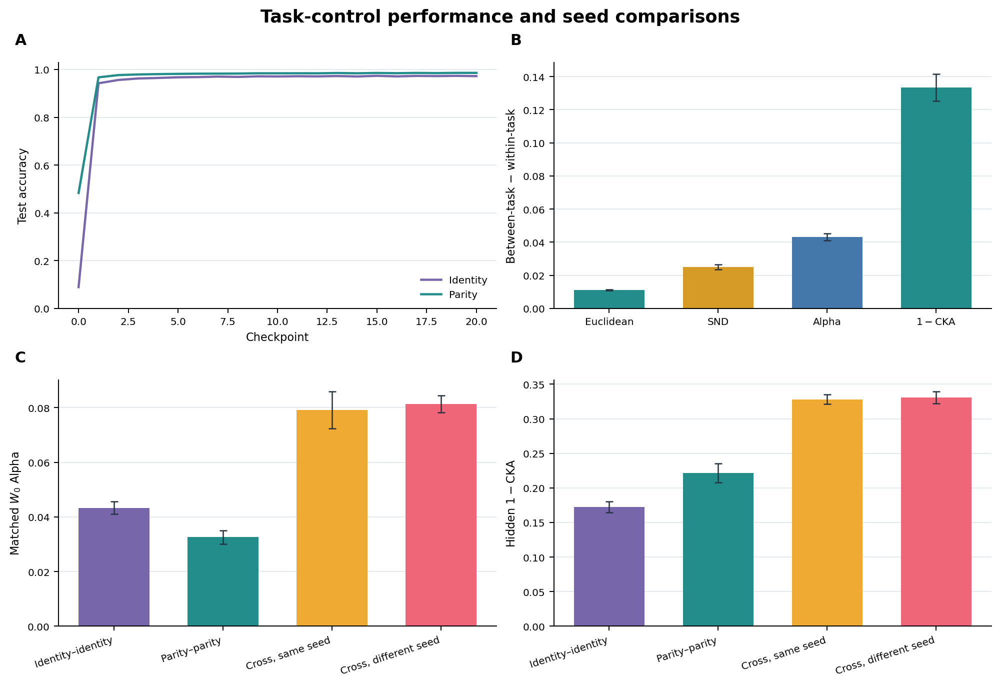

### figure_S05

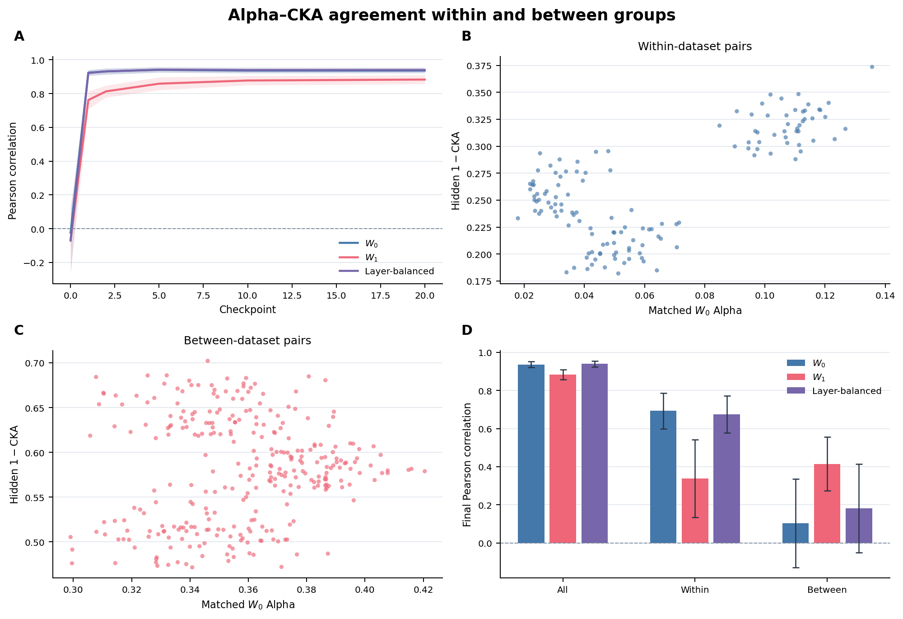

### figure_S06

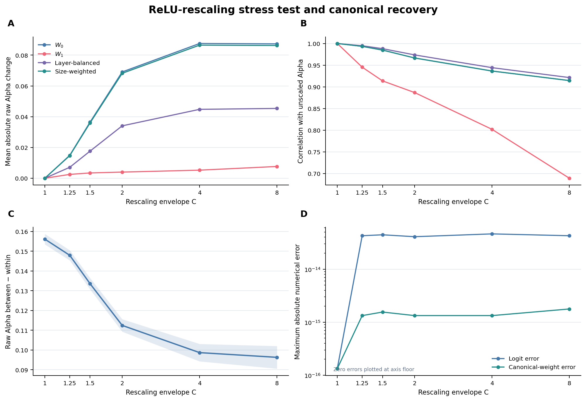

### figure_S07

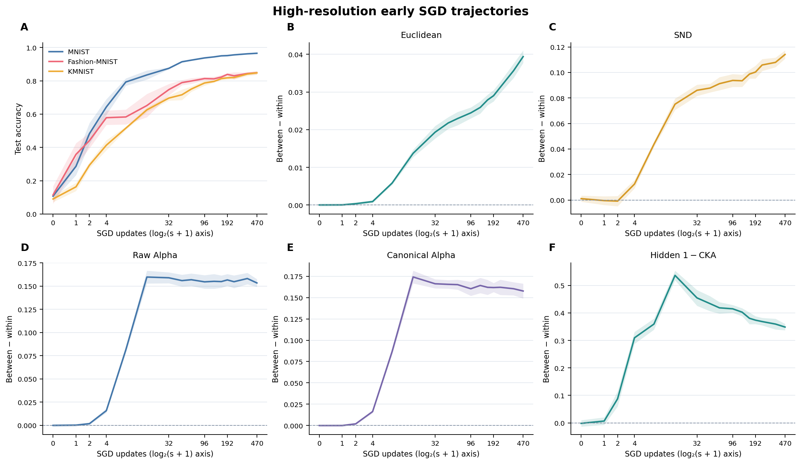

### figure_S08

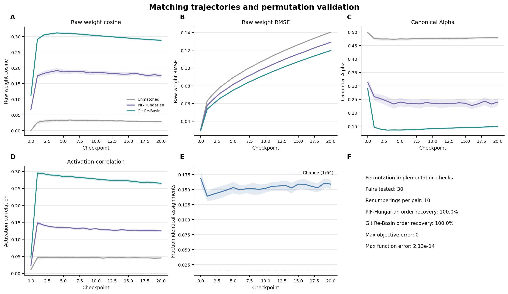

### figure_S09

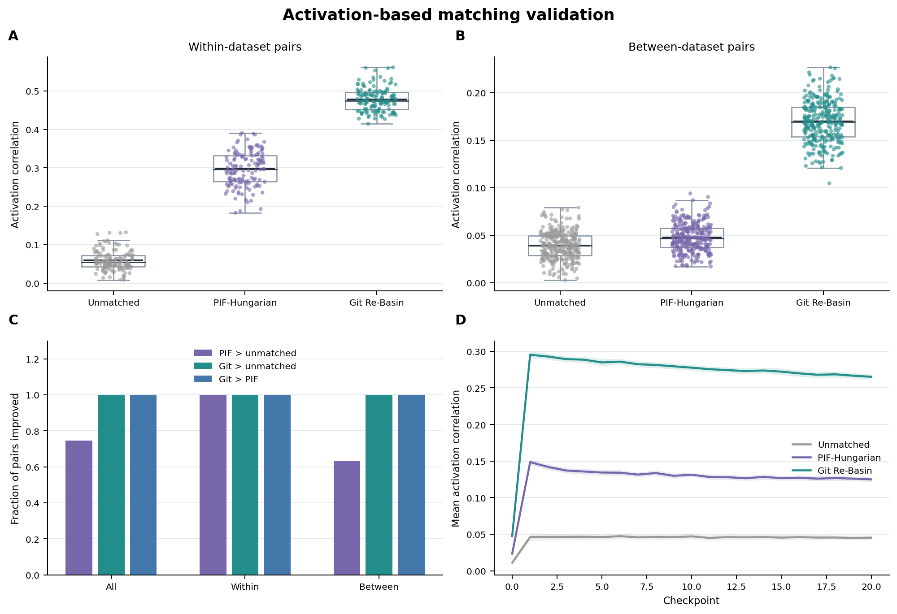

### figure_S10

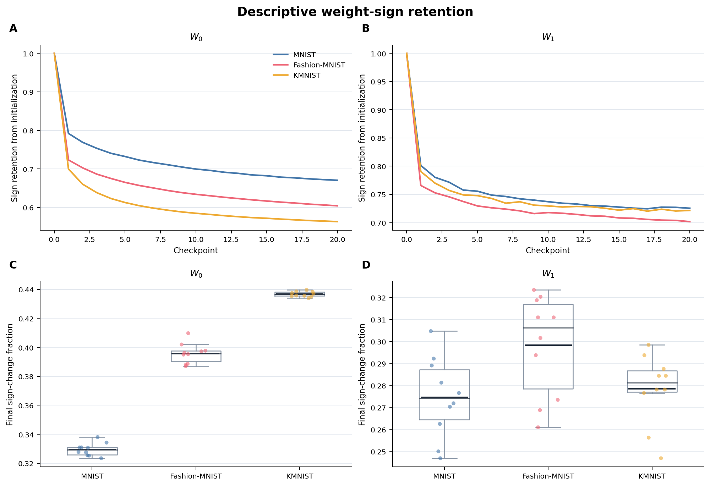

